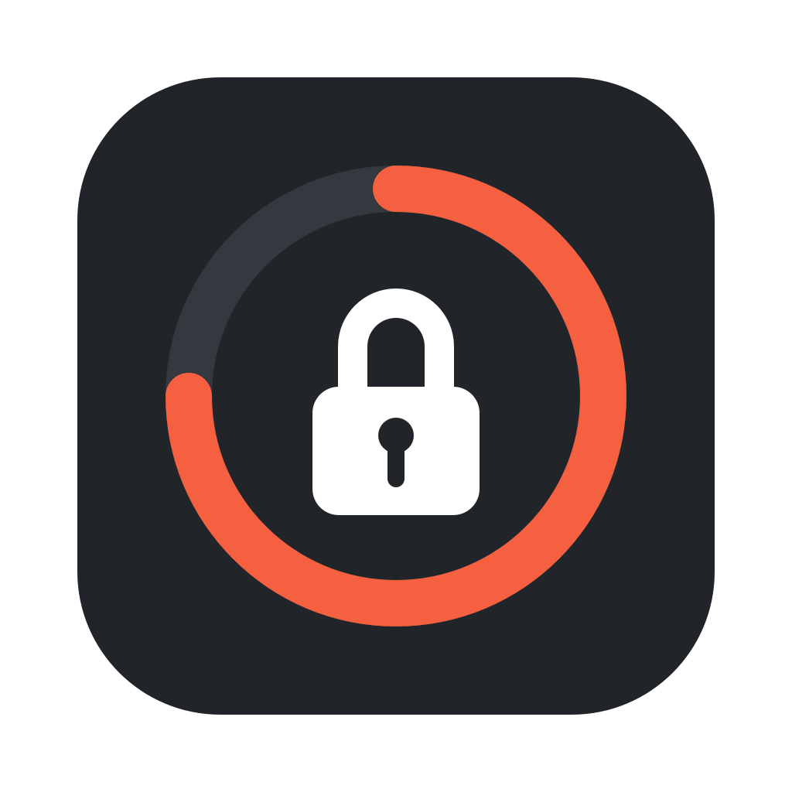

<p align="center">
  
</p>

<h1 align="center">TrayOTP</h1>

<p align="center">
  <b>English</b> · <a href="translations/README.de.md">Deutsch</a> · <a href="translations/README.es.md">Español</a> · <a href="translations/README.fr.md">Français</a> ·
  <a href="translations/README.it.md">Italiano</a> · <a href="translations/README.ja.md">日本語</a> · <a href="translations/README.ko.md">한국어</a> ·
  <a href="translations/README.pt-BR.md">Português (Brasil)</a> · <a href="translations/README.zh-Hans.md">简体中文</a> · <a href="translations/README.zh-Hant.md">繁體中文</a>
</p>

<p align="center">
  <b>Your two-factor codes, one click away in the macOS menu bar.</b><br>
  Imports from Google Authenticator, 2FAS, Aegis, Ente Auth, Bitwarden, Proton Authenticator and more. Encrypted, offline, open source.
</p>

<p align="center">
  <a href="https://github.com/outerstudio/trayotp/releases/latest"></a>
  <a href="https://github.com/outerstudio/trayotp/actions/workflows/ci.yml"></a>
  
  <a href="LICENSE"></a>
  <a href="https://buymeacoffee.com/garyyeap"></a>
</p>

<p align="center">
  <a href="#install">Install</a> ·
  <a href="#getting-started">Getting started</a> ·
  <a href="#using-trayotp">Using TrayOTP</a> ·
  <a href="#security">Security</a> ·
  <a href="#troubleshooting">Troubleshooting</a>
</p>

<p align="center">
  
</p>

## Features

- **Lives in the menu bar.** Click the tray icon, click a code, it's copied. No Dock icon, no window to manage.
- **Next code preview.** The upcoming code is shown on the right of each row, and a translucent fill behind the row shows the time left on the current one.
- **Keyboard only or just click, your call.** Global shortcut, type to search, ↩ to copy, ⌘↑/↓ to reorder, Esc to close.
  See [Copying codes](#copying-codes) and [Reorder](#groups).
- **Every common token type.** TOTP (SHA-1, SHA-256, SHA-512, 6–8 digits, any period), HOTP (counter-based) and Steam Guard.
- **Add tokens without a phone.** Paste an `otpauth://` link, a Base32 secret, or an image containing a QR code.
- **Move in or out freely.** Import from Google Authenticator, 2FAS, Aegis, Ente Auth, Bitwarden, Proton Authenticator,
  Stratum, andOTP, FreeOTP+, Raivo OTP and password manager CSVs. Export to 2FAS, Aegis, Ente Auth, Bitwarden and Google Authenticator.
- **Groups.** Collapsible sections, drag and drop to sort and move tokens, kept in 2FAS, Aegis and Ente exports.
- **Service icons.** Use any [Aegis icon pack](#service-icons), pick icons by hand, use your own images, or fetch a site's favicon.
- **Locked by default.** Touch ID (or your Mac password) before codes are shown, with an optional master password on top.
- **Secure.** Tokens are encrypted with AES-256-GCM, with the key kept in your login keychain. See [Security](#security).
- **Private.** Everything stays on your Mac. No account, no sync, no analytics.
- **In your language.** English, Deutsch, Español, Français, Italiano, 日本語, 한국어, Português (Brasil), 简体中文 and
  繁體中文. Follows your Mac's language, or pick one in **⋯ → Language**.
- **Small and native.** Swift and SwiftUI, a few MB. Requires macOS 14 Sonoma or later; runs on Apple silicon and Intel.

## Install

### Download

1. Download `TrayOTP-vX.Y.Z.zip` from the [latest release](https://github.com/outerstudio/trayotp/releases/latest).
2. Unzip it and move **TrayOTP.app** to your **Applications** folder.
3. Open it. The first time, macOS will say it can't verify the app (see below).

**Why the warning?** TrayOTP is open source and isn't signed with a paid Apple Developer certificate, so
macOS can't check who made it. To open it anyway:

- **macOS 15 Sequoia and later:** open the app once, close the warning, then go to
  **System Settings → Privacy & Security**, scroll down and click **Open Anyway** next to TrayOTP.
- **macOS 14 Sonoma:** right-click **TrayOTP.app** → **Open** → **Open**.

You only need to do this once per version. If you'd rather not trust a downloaded build,
[build it yourself](#build-from-source) in about a minute.

<!-- SCREENSHOT: docs/screenshots/open-anyway.png
     System Settings → Privacy & Security with the "Open Anyway" button for TrayOTP highlighted. -->

**Checking the download (optional):** each release includes a `.sha256` file. In Terminal:

```sh
shasum -a 256 -c TrayOTP-vX.Y.Z.zip.sha256
```

### Build from source

You only need Apple's **Command Line Tools**:

```sh
xcode-select --install                                 # skip if already installed
git clone https://github.com/outerstudio/trayotp.git
cd trayotp
make release                                           # builds build/TrayOTP.app
cp -R build/TrayOTP.app /Applications/
```

Apps you build yourself open without any warning.

## Getting started

1. Click the TrayOTP icon in the menu bar (a lock in a circle) and unlock with Touch ID.
2. Add your tokens:
   - **From another app:** click **Add → Import from File…**, or for Google Authenticator
     **Add → Scan QR Code with Camera…** (see [Import and export](#import-and-export)).
   - **One at a time:** click **Add** and paste the setup link or secret (see [Adding a token](#adding-a-token)).
3. Click any code to copy it.

## Using TrayOTP

### Copying codes

- **Open it from anywhere:** set a key combination in **⋯ → Set Global Shortcut…**, then press it in any app.
  **Esc** closes the panel and returns you to the app you were in.
- **Click a code** to copy it. A "Copied" message confirms it. Click the upcoming code on the right of the row (or right-click → **Copy Next Code**) to copy it instead.
- **Keyboard:** the search field is focused when the panel opens. Type to filter, use **↑/↓** to select, **Enter** (↩) to copy and **→** to copy the next code.
  **↑** from the top row goes back to the search field.
- For counter-based (HOTP) tokens, right-click → **Next Code** to advance the counter.
- **Edit a token:** right-click it → **Edit…** to change its service name and account. The code stays the same.
- **Close After Copying** in the ⋯ menu closes the panel after each copy, so you can paste right away.
- Copied codes are hidden from clipboard managers and cleared from the clipboard after 30 seconds.

### Adding a token

Click **Add** at the bottom of the panel, then paste one of:

| You have | What to do |
|---|---|
| An `otpauth://…` setup link | Paste it. Name, account and settings are filled in from the link. |
| A secret key like `JBSW Y3DP EHPK 3PXP` | Paste it and type a name (e.g. "GitHub"). Spaces and lowercase are fine. |
| A QR code on screen | Screenshot it to the clipboard (**⌃⇧⌘4**), or right-click the image → **Copy Image**. Then open **Add** (it fills in automatically) or click **Paste Link, Secret or QR Image**. |
| A QR code on another device or on paper | Click **Scan QR Code with Camera…** and hold it up to the Mac's camera. |

A live preview shows the code before you save it, so you can compare it with the website.

> **Tip: add a new token to your phone at the same time.** When a website shows its 2FA setup QR code, scan it
> with your phone app (Google Authenticator, 2FAS, Aegis…) *and* screenshot it into TrayOTP (**⌃⇧⌘4**, then **Add**).
> It's the same secret, so both show the same codes, and you keep a backup if you lose your phone or Mac.
> Do it before you type the confirmation code on the website: most sites never show the QR code again.
> No QR code? Copy the setup key (often under "Can't scan it?") and enter it in both apps.

### Groups

- **Create a group:** **⋯ → New Group…**, or right-click a token → **Move to Group → New Group…**.
- **Move a token:** right-click it → **Move to Group**, or drag it onto a group header.
- **Reorder:** drag a token onto another one: the top half of the row puts it above, the bottom half below.
  Or select it and press **⌘↑/⌘↓**; past the end of a group it moves into the next one. Drag a group header onto another one to reorder groups.
- **Collapse:** click a group header (Ungrouped too). Search always finds tokens in collapsed groups.
  Moving the selection into a collapsed group with ↑/↓ opens it until you move out; only clicking the header saves it
  open or closed.
- **Rename, move or delete a group:** right-click its header. Deleting a group keeps its tokens; they move to Ungrouped.

### Service icons

TrayOTP doesn't ship brand logos. Instead it reads icon packs in the
[Aegis icon pack format](https://github.com/beemdevelopment/Aegis/blob/master/docs/iconpacks.md):

1. Download `aegis-icons.zip` from [aegis-icons releases](https://github.com/aegis-icons/aegis-icons/releases)
   (or any other Aegis-compatible pack).
2. **⋯ → Install Aegis Icon Pack…** and choose the ZIP.

Tokens get an icon automatically by matching their issuer or name ("Google Workspace" → Google).
For anything else, right-click a token:

| Menu item | What it does |
|---|---|
| **Edit Icon…** | Adjust the current icon (only when the token has one, not initials) |
| **Choose Icon from Pack…** | Search the installed pack and pick an icon by hand |
| **Set Icon from File…** | Use an image file (PNG, JPEG, SVG, HEIC, PDF…) |
| **Paste Icon** | Use an image you copied |
| **Fetch Icon from Website…** | Download the site's favicon (you confirm the domain first) |
| **Remove Icon** | Go back to the automatic icon or colored initials |

To set many at once, **⋯ → Import Icons from Folder…** matches image file names to token names
(`github.png` → GitHub). An icon you chose always wins over the pack's automatic match.

> **Privacy note:** **Fetch Icon from Website…** downloads the favicon through DuckDuckGo's icon service, so
> DuckDuckGo sees that domain. It only happens when you choose it, never automatically.

### Import and export

**Import:** **Add → Import from File…**, then choose the file. TrayOTP detects the app and asks for the backup password if
the file is encrypted. Anything that can't be imported is listed afterwards.

**Export:** **⋯ → Export ▸**, then pick the app. TrayOTP asks for Touch ID first.

| App | Import | Export | Groups |
|---|---|---|---|
| **2FAS** (`.2fas`) | Plain or encrypted | Plain or encrypted | ✓ |
| **Aegis** (`.json`) | Plain or encrypted | Plain or encrypted | ✓ (and icons) |
| **Ente Auth** (`.txt`) | Plain text | Plain text | ✓ (as tags) |
| **Google Authenticator** | "Transfer accounts" QR codes | QR codes (30 s, 6 or 8 digits) | — |
| **Bitwarden** and **Bitwarden Authenticator** (`.json`, `.csv`) | Unencrypted | Unencrypted JSON (no HOTP) | ✓ (folders) |
| **Proton Authenticator** (`.json`) | Plain or encrypted | — | — |
| **Stratum** / Authenticator Pro | Plain or encrypted | — | ✓ (categories) |
| **andOTP** (`.json`, `.json.aes`) | Plain or encrypted | — | ✓ (first tag) |
| **FreeOTP+** (`.json`) | ✓ | — | — |
| **Raivo OTP** (`.zip`, untested, [please report](https://github.com/outerstudio/trayotp/issues)) | Password-protected ZIP | — | — |
| **Apple Passwords** (`.csv`) | Verification codes (`OTPAuth` column) | — | — |
| **Other password managers** (`.csv`, untested, [please report](https://github.com/outerstudio/trayotp/issues)): 1Password, KeePassXC… | A column named `OTPAuth`, `TOTP` or `login_totp` | — | ✓ (folder/group) |
| Any text file of `otpauth://` links | ✓ | ✓ | — |

**Google Authenticator:** on your phone, open **⋮ → Transfer accounts → Export accounts**. Google blocks screenshots
of this screen, so in TrayOTP click **Add → Scan QR Code with Camera…** and hold the phone up to the Mac's camera,
about 20–30 cm away with the brightness up. All accounts in the code are imported at once. If Google shows several
QR codes, scan each one. Dense codes are harder for a webcam to read: if it doesn't pick one up, export fewer
accounts at a time.

No built-in camera (Mac mini, Mac Studio, Mac Pro)? A USB webcam works, and so does an iPhone or iPad other than the
one running Google Authenticator, used as a webcam (Continuity Camera). Or take a photo of the transfer screen
with another phone, get it onto your Mac (AirDrop, iCloud Photos, email…) and import it with
**Add → Import from File…**: PNG, JPEG and HEIC all work.

**To Google Authenticator:** **⋯ → Export → Google Authenticator (QR Codes)…** shows the accounts as QR codes,
10 per code. In Google Authenticator, open **⋮ → Transfer accounts → Import accounts** and scan each one. Google
only takes 30-second codes with 6 or 8 digits, so other tokens (and Steam) are left out, and you're told which.
The window hides from screenshots and screen sharing and closes when TrayOTP locks.

**Duplicates:** a token is skipped when you already have one with the same secret and account, so importing the same
file twice (or overlapping Google QR codes) adds nothing new. A token with the same name and account as one you have but a
different secret is kept, with the time it was added after the name (e.g. `GitHub 2026-11-17 23:40`), and listed
after the import. That usually means the site issued a new secret, so delete the old token once the new one works.
The same applies when you add a token one at a time.

**Untested** means TrayOTP reads the format as documented, but hasn't been tried with a file exported from that
app yet. If an import fails or the codes don't match, please
[open an issue](https://github.com/outerstudio/trayotp/issues) naming the app and its version (never attach the file:
it contains your secrets).

> **Before deleting tokens from your old app,** check that a few imported codes match the ones it shows.

Not supported: encrypted Ente Auth exports (export as plain text from Ente instead), encrypted Bitwarden exports,
the original FreeOTP's backups, Authy and Microsoft Authenticator (they can't export), and Yandex and mOTP tokens.

> **Unencrypted exports contain all your secrets in plain text.** Delete the file once you've imported it.
> For a backup you keep, use **Aegis (Encrypted)**: its password protection (scrypt) is much harder to crack
> than 2FAS's.

### Lock and security settings

All in the **⋯** menu:

| Setting | What it does |
|---|---|
| **Require Unlock** | Ask for Touch ID or your Mac password before showing codes (on by default). |
| **Stay Unlocked ▸** | How long TrayOTP stays unlocked after you last used it: every time, 1 minute to 1 hour, **Until Mac Sleeps or Locks**, or a custom number of minutes. It always locks when your Mac sleeps or the screen locks. |
| **Set Master Password…** | Protect the vault with a password of your own, typed instead of Touch ID (see [Security](#security)). |
| **Set Global Shortcut…** | Open the panel from any app with a key combination of your choice (needs ⌘, ⌃ or ⌥). |
| **Show Menu Bar Icon** | Turn off to hide the tray icon. The global shortcut (or opening TrayOTP again from Finder or Launchpad) then shows the panel near the top of the screen. |
| **Close After Copying** | Close the panel as soon as a code is copied, so you can paste it right away. |
| **Launch at Login** | Start TrayOTP when you log in. |
| **Language ▸** | **System Default** follows your Mac's language (English if TrayOTP isn't translated into it), or pick one of the translations. TrayOTP restarts to switch. |

Click **Lock** at the bottom of the panel to lock right away.

<p align="center">
  
</p>

## Security

### How your secrets are stored

- Tokens are stored encrypted (**AES-256-GCM**) on your Mac, in a file only your user account can read.
- The encryption key is a random 256-bit key kept in your **login keychain**, never next to the file.
- With **Require Unlock** on, the vault is decrypted only after Touch ID or your Mac password, and the decrypted
  tokens are dropped from memory when it locks again.
- **Exporting** and **deleting a token** always ask for Touch ID again, even while TrayOTP is unlocked.
- Nothing leaves your Mac, except a domain you choose to look up with **Fetch Icon from Website…**.
- The camera is used only while the **Scan QR Code** window is open. Frames are read in memory and never saved.
  macOS asks for camera access the first time, and may ask again after an update (TrayOTP is ad-hoc signed).

### Optional master password

With **⋯ → Set Master Password…**, the vault key in the Keychain is itself encrypted with a key derived from your
password (scrypt with N=2¹⁷, r=8, p=1: about 0.5 s and 128 MB per guess). Someone who gets into your keychain
still has to guess the password. You then unlock with the password instead of Touch ID.

Setting, changing or removing the master password switches to a new vault key, so old copies of the keychain
(for example in a Time Machine backup) can't open the vault afterwards.

> **If you forget the master password, your tokens cannot be recovered.** Keep an encrypted export somewhere safe.

### Limitations

- TrayOTP isn't signed with an Apple Developer certificate, so macOS doesn't let it bind the vault key to Touch ID
  inside the Keychain. Touch ID is enforced by the app, and another app asking for the key triggers a macOS
  **"wants to use your keychain"** prompt. You should only see that prompt right after updating TrayOTP, when you
  open it. **If it appears at any other time, or names an app other than TrayOTP, click Deny:** something else is
  trying to read the key that protects your tokens.
- Your seeds are only as safe as your Mac. Turn on **FileVault**, **encrypt your Time Machine backups**, and use a strong
  login password. If both the vault file and your login keychain were stolen, the login password is what stands in
  the way (plus the master password, if you set one).
- Builds use the hardened runtime, which blocks other processes from injecting code into TrayOTP or attaching a
  debugger to it.

Found a security problem? Please report it privately through the repository's
[Security tab](https://github.com/outerstudio/trayotp/security) rather than in a public issue.

## Troubleshooting

**"TrayOTP wants to use your keychain" after an update**
macOS asks again after each update because every release is signed separately. Enter your login keychain
password (normally your Mac password) and choose **Always Allow**. If it appears at any other time, see
[Limitations](#limitations).

**Launchpad shows a blank icon**
Launchpad only lists apps in `/Applications`. If the icon is still blank after moving the app there, run `killall Dock`.

**A QR code isn't detected**
Crop the screenshot closer to the code. For Google Authenticator, use **Add → Scan QR Code with Camera…** (see
[Import and export](#import-and-export)).

**"Wrong backup password"**
Use the password set when the backup was exported from the other app (or TrayOTP), not your Mac password.

## Use at your own risk

TrayOTP is free, open-source software provided as is, without warranty of any kind (see the [license](LICENSE)).
The authors aren't responsible for lost access to your accounts, lost or leaked secrets, or any other damage.

Losing your 2FA codes can lock you out of your accounts, so don't let TrayOTP be your only copy:

- Save each site's **recovery codes** when you set up 2FA.
- Keep the token in a second app too, such as your phone (see the tip under [Adding a token](#adding-a-token)).
- Export an encrypted backup now and then (**⋯ → Export → Aegis (Encrypted)**) and keep it somewhere safe.
- After importing, check a few codes before deleting anything from your old app.

## Support

TrayOTP is free. If it saves you time, you can [buy me a coffee](https://buymeacoffee.com/garyyeap) (also in the ⋯
menu).

## Development

Requires macOS 14 and the Command Line Tools.

```sh
make test      # fetch third-party test exports, then run the test suite (optimized build)
make run       # build build/TrayOTP.app, quit the running copy, launch the new one
make release   # build only
make icon      # redraw Support/AppIcon.icns from Scripts/make-icon.swift
make strings   # check the translations against the strings in Sources/
```

`make test` and `make run` build optimized: Aegis vault decryption (scrypt) takes about 40 s in an unoptimized
build and 0.1 s in an optimized one.

### Project layout

```
Sources/OTPCore/          pure logic, no UI, fully tested
  OTP.swift               HOTP / TOTP / Steam codes (CryptoKit)
  Base32.swift            lenient Base32
  OTPAuthURI.swift        otpauth:// parsing and building
  TwoFAS.swift            2FAS import/export (PBKDF2-SHA256 + AES-256-GCM)
  Aegis.swift             Aegis import/export (scrypt + AES-256-GCM)
  Ente.swift              Ente Auth and otpauth link lists
  GoogleAuthenticator.swift  otpauth-migration:// transfer codes (protobuf)
  Bitwarden.swift, ProtonAuthenticator.swift, Stratum.swift, AndOTP.swift, FreeOTPPlus.swift, Raivo.swift,
  PasswordCSV.swift       other apps' exports
  Zip.swift               ZIP reader with WinZip AES (Raivo)
  Argon2.swift            Argon2id and BLAKE2b (Proton, Stratum)
  Importer.swift          format detection; Exporter
  MasterPassword.swift    scrypt-wrapped vault key
  IconPack.swift          Aegis icon pack manifest and matching
  SVGPathFixer.swift      rewrites minified SVG paths that macOS draws wrongly
  CryptoUtil.swift        PBKDF2, hex, scrypt (RFC 7914)
Sources/TrayOTP/          SwiftUI MenuBarExtra app
  AppState.swift          lock state, tokens, groups, import/export, settings
  VaultStore.swift        encrypted vault file + Keychain key, crash-safe key changes
  IconPackStore.swift     installed icon pack, rendering and caching
  Views/                  panel, rows, groups, lock, add and icon picker screens
Sources/OTPCoreTests/     test runner (XCTest needs Xcode, so it's a plain executable)
Support/Localizations/    <lang>.lproj translations (Localizable.strings, InfoPlist.strings)
Scripts/                  bundle.sh (build .app), make-icon.swift, fetch-test-fixtures.sh, extract-strings.py
```

### Translations

User-facing text is written in English in the code, as SwiftUI literals or `String(localized:)`, and the English text
is the key in each `Support/Localizations/<lang>.lproj/Localizable.strings`. Without Xcode there is no `genstrings`, so
`Scripts/extract-strings.py` lists the keys and `make strings` (also run in CI) checks that every translation has
each one, no leftovers, and the same `%@` / `%lld` arguments.

- **Change or add a string:** edit the code, run `Scripts/extract-strings.py` to see the new key, and add it to every
  `Localizable.strings`. A number interpolated into a string needs its variable name in `INTS` in the script.
- **Fix a translation:** edit the value (right of `=`) and run `make strings`.
- **Add a language:** copy a `.lproj` folder to `Support/Localizations/<code>.lproj`, translate the values (keep the
  keys), and add the code to `AppState.languages` so it shows in **⋯ → Language**.

The translations were not reviewed by native speakers; corrections are welcome.

### Tests

The suite covers the RFC 4226 / 6238 / 7914 / 9106 test vectors (HOTP, TOTP, scrypt, Argon2id), BLAKE2b, otpauth parsing, and import/export round trips for every
format. To check compatibility with files the other apps really produce, `Scripts/fetch-test-fixtures.sh` downloads
real exports from the [2fas-backup-decryptor](https://github.com/elliotwutingfeng/2fas-backup-decryptor) and
[Aegis](https://github.com/beemdevelopment/Aegis) test suites into `ThirdPartyFixtures/`, pinned by SHA-256.
They're GPL-licensed, so they aren't committed; without them those checks are skipped. The Raivo ZIP test needs
`7z` (`brew install p7zip`) and is skipped without it.

### Format notes

- **2FAS:** encrypted backups store `servicesEncrypted` as `cipher:salt:iv` (Base64). Key: PBKDF2-HMAC-SHA256,
  10,000 iterations, 32 bytes; cipher: AES-256-GCM with the 16-byte tag at the end of `cipher`; 256-byte salt,
  12-byte IV. `reference` is a fixed string encrypted the same way, used to check the password.
- **Aegis:** a random master key encrypts `db` (AES-256-GCM, hex nonce and tag in `header.params`); each password
  slot wraps the master key with scrypt(password, N=2¹⁵, r=8, p=1).
- **Ente Auth:** plain-text exports are `otpauth://` links with a `codeDisplay` JSON parameter (tags, trashed flag).
- **Google Authenticator:** `otpauth-migration://offline?data=` + Base64 of a `MigrationPayload` protobuf.
- **Proton Authenticator:** Argon2id (t=2, m=19 MiB, p=1) + AES-256-GCM, associated data `proton.authenticator.export.v1`.
- **Stratum:** `AUTHENTICATORPRO` header, Argon2id (t=3, m=64 MiB, p=4) + AES-256-GCM; the legacy `AuthenticatorPro`
  header uses PBKDF2-SHA1 (64,000 iterations) + AES-256-CBC.
- **andOTP:** PBKDF2-SHA1 (iterations stored in the file) + AES-256-GCM; older files use SHA-256(password) as the key.
- **Raivo OTP:** a WinZip AES ZIP (PBKDF2-SHA1, AES-CTR, HMAC-SHA1) containing `raivo-otp-export.json`.

### Releasing

Push a version tag. GitHub Actions runs the tests, builds a universal app and publishes the release with a checksum:

```sh
git tag v0.1.0 && git push origin v0.1.0
```

## Credits

- Backup formats follow the open-source [2FAS](https://github.com/twofas) and [Aegis](https://github.com/beemdevelopment/Aegis) apps.
- Service icons come from icon packs you install yourself, such as [aegis-icons](https://github.com/aegis-icons/aegis-icons).
- Favicons are fetched through [DuckDuckGo](https://duckduckgo.com)'s icon service.

TrayOTP is not affiliated with 2FAS, Aegis, Ente, Google, Bitwarden, Proton or any other app it imports from, nor
with any service whose logo it displays. Logos are trademarks of their
respective owners, used only to identify each service.

## License

[MIT](LICENSE) © 2026 outerstudio.com
