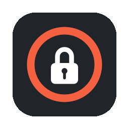
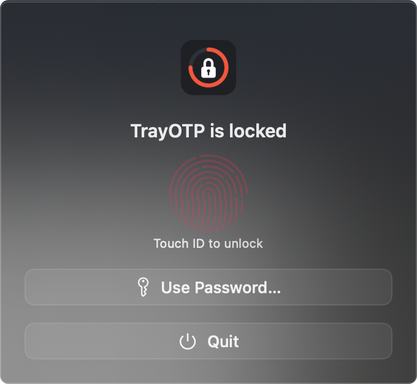

<p align="center">
  
</p>

<h1 align="center">TrayOTP</h1>

<p align="center">
  <a href="../README.md">English</a> · <a href="README.de.md">Deutsch</a> · <b>Español</b> · <a href="README.fr.md">Français</a> ·
  <a href="README.it.md">Italiano</a> · <a href="README.ja.md">日本語</a> · <a href="README.ko.md">한국어</a> ·
  <a href="README.pt-BR.md">Português (Brasil)</a> · <a href="README.zh-Hans.md">简体中文</a> · <a href="README.zh-Hant.md">繁體中文</a>
</p>

<p align="center">
  <b>Tus códigos de doble factor, a un clic en la barra de menús de macOS.</b><br>
  Importa desde Google Authenticator, 2FAS, Aegis, Ente Auth, Bitwarden, Proton Authenticator y más. Cifrado, sin conexión, de código abierto.
</p>

<p align="center">
  <a href="https://github.com/outerstudio/trayotp/releases/latest"></a>
  <a href="https://github.com/outerstudio/trayotp/actions/workflows/ci.yml"></a>
  
  <a href="../LICENSE"></a>
  <a href="https://buymeacoffee.com/garyyeap"></a>
  <a href="https://ko-fi.com/garyyeap"></a>
  <a href="https://liberapay.com/garyyeap"></a>
  <a href="https://thanks.dev/u/gh/garyyeap"></a>
</p>

<p align="center">
  <a href="#install">Instalación</a> ·
  <a href="#getting-started">Primeros pasos</a> ·
  <a href="#using-trayotp">Uso de TrayOTP</a> ·
  <a href="#security">Seguridad</a> ·
  <a href="#troubleshooting">Solución de problemas</a>
</p>

<p align="center">
  
  
</p>

> Esta traducción puede ir por detrás del [README en inglés](../README.md). En caso de duda, prevalece la versión en inglés.

## Funciones

- **Vive en la barra de menús.** Haz clic en el icono, haz clic en un código y queda copiado. Sin icono en el Dock, sin ventanas que gestionar.
- **Vista previa del siguiente código.** El próximo código aparece a la derecha de cada fila, y un relleno translúcido detrás de la fila muestra el tiempo que le queda al actual.
- **Solo teclado o solo clics, tú decides.** Atajo global, escribe para buscar, ↩ para copiar, ⌘↑/↓ para reordenar, Esc para cerrar.
  Consulta [Copiar códigos](#copying-codes) y [Grupos](#groups).
- **Todos los tipos de token habituales.** TOTP (SHA-1, SHA-256, SHA-512, 6–8 dígitos, cualquier periodo), HOTP (basado en contador) y Steam Guard.
- **Añade tokens sin teléfono.** Pega un enlace `otpauth://`, un secreto Base32 o una imagen con un código QR.
- **Entra y sal con libertad.** Importa desde Google Authenticator, 2FAS, Aegis, Ente Auth, Bitwarden, Proton Authenticator,
  Stratum, andOTP, FreeOTP+, Raivo OTP y CSV de gestores de contraseñas. Exporta a 2FAS, Aegis, Ente Auth, Bitwarden y Google Authenticator.
- **Grupos.** Secciones contraíbles, arrastrar y soltar para ordenar y mover tokens; se conservan en las exportaciones de 2FAS, Aegis y Ente.
- **Iconos de servicios.** Usa cualquier [paquete de iconos de Aegis](#service-icons), elige iconos a mano, usa tus propias imágenes u obtén el favicon de un sitio.
- **Bloqueado por defecto.** Touch ID (o la contraseña del Mac) antes de mostrar códigos, con una contraseña maestra opcional además.
- **Seguro.** Los tokens se cifran con AES-256-GCM y la clave se guarda en tu llavero de inicio de sesión. Consulta [Seguridad](#security).
- **Privado.** Todo se queda en tu Mac. Sin cuenta, sin sincronización, sin analíticas.
- **En tu idioma.** English, Deutsch, Español, Français, Italiano, 日本語, 한국어, Português (Brasil), 简体中文 y
  繁體中文. Sigue el idioma de tu Mac, o elige uno en **⋯ → Idioma**.
- **Pequeño y nativo.** Swift y SwiftUI, pocos MB. Requiere macOS 14 Sonoma o posterior; funciona en Apple silicon e Intel.

<a id="install"></a>
## Instalación

### Descarga

1. Descarga `TrayOTP-vX.Y.Z.zip` de la [última versión](https://github.com/outerstudio/trayotp/releases/latest).
2. Descomprímelo y mueve **TrayOTP.app** a la carpeta **Aplicaciones**.
3. Ábrelo. La primera vez, macOS dirá que no puede verificar la app (ver abajo).

**¿Por qué el aviso?** TrayOTP es de código abierto y no está firmado con un certificado de pago de Apple Developer, así que
macOS no puede comprobar quién lo creó. Para abrirlo de todos modos:

- Sigue la [guía de Apple para abrir una app de un desarrollador desconocido](https://support.apple.com/es-es/guide/mac-help/mh40616/26/mac/26) y elige tu versión de macOS en esa página.

Solo hay que hacerlo una vez por versión. Si prefieres no fiarte de una versión descargada,
[compílala tú mismo](#build-from-source) en un minuto aproximadamente.

**Comprobar la descarga (opcional):** cada versión incluye un archivo `.sha256`. En Terminal:

```sh
shasum -a 256 -c TrayOTP-vX.Y.Z.zip.sha256
```

<a id="build-from-source"></a>
### Compilar desde el código fuente

Solo necesitas las **Command Line Tools** de Apple:

```sh
xcode-select --install                                 # omítelo si ya están instaladas
git clone https://github.com/outerstudio/trayotp.git
cd trayotp
make release                                           # compila build/TrayOTP.app
cp -R build/TrayOTP.app /Applications/
```

Las apps que compilas tú se abren sin ningún aviso.

<a id="getting-started"></a>
## Primeros pasos

1. Haz clic en el icono de TrayOTP en la barra de menús (un candado en un círculo) y desbloquea con Touch ID.
2. Añade tus tokens:
   - **Desde otra app:** haz clic en **Añadir → Importar desde archivo…**, o para Google Authenticator en
     **Añadir → Escanear código QR con la cámara…** (consulta [Importar y exportar](#import-and-export)).
   - **De uno en uno:** haz clic en **Añadir** y pega el enlace de configuración o el secreto (consulta [Añadir un token](#adding-a-token)).
3. Haz clic en cualquier código para copiarlo.

<a id="using-trayotp"></a>
## Uso de TrayOTP

<a id="copying-codes"></a>
### Copiar códigos

- **Ábrelo desde cualquier sitio:** define una combinación de teclas en **⋯ → Establecer atajo global…** y púlsala en cualquier app.
  **Esc** cierra el panel y te devuelve a la app en la que estabas.
- **Haz clic en un código** para copiarlo. Un mensaje lo confirma. Haz clic en el siguiente código a la derecha de la fila (o clic derecho → **Copiar siguiente código**) para copiar ese.
- **Teclado:** el campo de búsqueda está activo al abrir el panel. Escribe para filtrar, **↑/↓** para seleccionar, **Intro** (↩) para copiar y **→** para copiar el siguiente código.
  **↑** desde la primera fila vuelve al campo de búsqueda.
- En los tokens basados en contador (HOTP), clic derecho → **Siguiente código** para avanzar el contador.
- **Editar un token:** clic derecho → **Editar…** para cambiar el nombre del servicio y la cuenta. El código sigue siendo el mismo.
- **Ocultar siempre el código de un token:** clic derecho → **Ocultar siempre el código**. Sigue oculto incluso con **Ocultar códigos** en **Nunca**, hasta que hagas clic en él.
- **Cerrar después de copiar**, en el menú ⋯, cierra el panel tras cada copia para que puedas pegar enseguida.
- Los códigos copiados se ocultan a los gestores de portapapeles y se borran del portapapeles a los 30 segundos.

<a id="adding-a-token"></a>
### Añadir un token

Haz clic en **Añadir** en la parte inferior del panel y pega una de estas cosas:

| Tienes | Qué hacer |
|---|---|
| Un enlace de configuración `otpauth://…` | Pégalo. El nombre, la cuenta y los ajustes se toman del enlace. |
| Una clave secreta como `JBSW Y3DP EHPK 3PXP` | Pégala y escribe un nombre (p. ej. «GitHub»). Los espacios y las minúsculas no importan. |
| Un código QR en pantalla | Haz una captura al portapapeles (**⌃⇧⌘4**) o clic derecho en la imagen → **Copiar imagen**. Luego abre **Añadir** (se rellena solo) o haz clic en **Pegar enlace, secreto o imagen QR**. |
| Un código QR en otro dispositivo o en papel | Haz clic en **Escanear código QR con la cámara…** y colócalo delante de la cámara del Mac. |

Una vista previa en directo muestra el código antes de guardarlo, para que lo compares con el sitio web.

> **Consejo: añade también el nuevo token a tu teléfono a la vez.** Cuando un sitio muestre su código QR de configuración de 2FA,
> escanéalo con la app del teléfono (Google Authenticator, 2FAS, Aegis…) *y* haz una captura para TrayOTP (**⌃⇧⌘4** y luego **Añadir**).
> Es el mismo secreto, así que ambos muestran los mismos códigos, y tienes una copia si pierdes el teléfono o el Mac.
> Hazlo antes de escribir el código de confirmación en el sitio: la mayoría nunca vuelve a mostrar el código QR.
> ¿No hay código QR? Copia la clave de configuración (a menudo bajo «¿No puedes escanearlo?») e introdúcela en ambas apps.

<a id="groups"></a>
### Grupos

- **Crear un grupo:** **⋯ → Nuevo grupo…**, o clic derecho en un token → **Mover al grupo → Nuevo grupo…**.
- **Mover un token:** clic derecho → **Mover al grupo**, o arrástralo sobre la cabecera de un grupo.
- **Reordenar:** arrastra un token sobre otro: la mitad superior de la fila lo coloca encima y la inferior debajo.
  O selecciónalo y pulsa **⌘↑/⌘↓**; al pasar del final de un grupo entra en el siguiente. Arrastra la cabecera de un grupo sobre otra para reordenar los grupos.
- **Contraer:** haz clic en la cabecera de un grupo («Sin grupo» también). La búsqueda siempre encuentra tokens de grupos contraídos.
  Mover la selección a un grupo contraído con ↑/↓ lo abre hasta que sales; solo un clic en la cabecera guarda si queda
  abierto o cerrado.
- **Renombrar, mover o eliminar un grupo:** clic derecho en su cabecera. Eliminar un grupo conserva sus tokens; pasan a «Sin grupo».

<a id="service-icons"></a>
### Iconos de servicios

TrayOTP no incluye logotipos de marcas. En su lugar lee paquetes de iconos en el
[formato de paquete de iconos de Aegis](https://github.com/beemdevelopment/Aegis/blob/master/docs/iconpacks.md):

1. Descarga `aegis-icons.zip` de las [versiones de aegis-icons](https://github.com/aegis-icons/aegis-icons/releases)
   (o cualquier otro paquete compatible con Aegis).
2. **⋯ → Paquete de iconos → Instalar paquete de iconos de Aegis…** y elige el ZIP.

Los tokens reciben un icono automáticamente según su emisor o nombre («Google Workspace» → Google).
Para lo demás, clic derecho en un token:

| Opción del menú | Qué hace |
|---|---|
| **Editar icono…** | Ajustar el icono actual (solo si el token tiene uno, no iniciales) |
| **Elegir icono del paquete…** | Buscar en el paquete instalado y elegir un icono a mano |
| **Establecer icono desde archivo…** | Usar un archivo de imagen (PNG, JPEG, SVG, HEIC, PDF…) |
| **Pegar icono** | Usar una imagen que hayas copiado |
| **Obtener icono del sitio web…** | Descargar el favicon del sitio (primero confirmas el dominio) |
| **Quitar icono** | Volver al icono automático o a las iniciales de color |

Para establecer muchos a la vez, **⋯ → Paquete de iconos → Importar iconos desde carpeta…** asocia los nombres de archivo de imagen con los nombres de los tokens
(`github.png` → GitHub). Un icono elegido por ti siempre tiene prioridad sobre la coincidencia automática del paquete.

> **Nota de privacidad:** **Obtener icono del sitio web…** descarga el favicon mediante el servicio de iconos de DuckDuckGo, así que
> DuckDuckGo ve ese dominio. Solo ocurre cuando lo eliges, nunca automáticamente.

<a id="import-and-export"></a>
### Importar y exportar

**Importar:** **Añadir → Importar desde archivo…** y elige el archivo. TrayOTP detecta la app y pide la contraseña de la copia si
el archivo está cifrado. Lo que no se puede importar se lista después.

**Exportar:** **⋯ → Copia y exportación ▸ → Exportar a otra app ▸** y elige la app. TrayOTP pide primero Touch ID.

| App | Importar | Exportar | Grupos |
|---|---|---|---|
| **2FAS** (`.2fas`) | Sin cifrar o cifrado | Sin cifrar o cifrado | ✓ |
| **Aegis** (`.json`) | Sin cifrar o cifrado | Sin cifrar o cifrado | ✓ (e iconos) |
| **Ente Auth** (`.txt`) | Texto sin formato | Texto sin formato | ✓ (como etiquetas) |
| **Google Authenticator** | Códigos QR de «Transferir cuentas» | Códigos QR (30 s, 6 u 8 dígitos) | — |
| **Bitwarden** y **Bitwarden Authenticator** (`.json`, `.csv`) | Sin cifrar | JSON sin cifrar (sin HOTP) | ✓ (carpetas) |
| **Proton Authenticator** (`.json`) | Sin cifrar o cifrado | — | — |
| **Stratum** / Authenticator Pro | Sin cifrar o cifrado | — | ✓ (categorías) |
| **andOTP** (`.json`, `.json.aes`) | Sin cifrar o cifrado | — | ✓ (primera etiqueta) |
| **FreeOTP+** (`.json`) | ✓ | — | — |
| **Raivo OTP** (`.zip`, sin probar, [avísanos](https://github.com/outerstudio/trayotp/issues)) | ZIP protegido con contraseña | — | — |
| **Contraseñas de Apple** (`.csv`) | Códigos de verificación (columna `OTPAuth`) | — | — |
| **Otros gestores de contraseñas** (`.csv`, sin probar, [avísanos](https://github.com/outerstudio/trayotp/issues)): 1Password, KeePassXC… | Una columna llamada `OTPAuth`, `TOTP` o `login_totp` | — | ✓ (carpeta/grupo) |
| Cualquier archivo de texto con enlaces `otpauth://` | ✓ | ✓ | — |

**Google Authenticator:** en el teléfono, abre **⋮ → Transferir cuentas → Exportar cuentas**. Google bloquea las capturas de
esta pantalla, así que en TrayOTP haz clic en **Añadir → Escanear código QR con la cámara…** y coloca el teléfono delante de la
cámara del Mac, a unos 20–30 cm y con el brillo alto. Todas las cuentas del código se importan de una vez. Si Google muestra
varios códigos QR, escanea cada uno. Los códigos densos son más difíciles de leer para una cámara web: si no detecta alguno,
exporta menos cuentas a la vez.

¿Sin cámara integrada (Mac mini, Mac Studio, Mac Pro)? Sirve una cámara web USB, y también un iPhone o iPad (que no sea el que
tiene Google Authenticator) usado como cámara web (Cámara de Continuidad). O haz una foto de la pantalla de transferencia con
otro teléfono, pásala al Mac (AirDrop, Fotos de iCloud, correo…) e impórtala con
**Añadir → Importar desde archivo…**: funcionan PNG, JPEG y HEIC.

**A Google Authenticator:** **⋯ → Copia y exportación → Exportar a otra app → Google Authenticator (códigos QR)…** muestra las cuentas como códigos QR,
10 por código. En Google Authenticator, abre **⋮ → Transferir cuentas → Importar cuentas** y escanea cada uno. Google solo
admite códigos de 30 segundos con 6 u 8 dígitos, así que los demás tokens (y Steam) se omiten, y se te indica cuáles.
La ventana se oculta en capturas y al compartir pantalla, y se cierra cuando TrayOTP se bloquea.

**Duplicados:** un token se omite si ya tienes uno con el mismo secreto y la misma cuenta, así que importar el mismo archivo dos
veces (o códigos QR de Google que se solapan) no añade nada nuevo. Un token con el mismo nombre y cuenta que uno existente pero con
otro secreto se conserva, con la hora en que se añadió tras el nombre (p. ej. `GitHub 2026-11-17 23:40`), y se lista tras la
importación. Normalmente significa que el sitio emitió un secreto nuevo, así que elimina el token antiguo cuando el nuevo
funcione. Lo mismo ocurre al añadir un token de uno en uno.

**Sin probar** significa que TrayOTP lee el formato según su documentación, pero aún no se ha probado con un archivo exportado
desde esa app. Si una importación falla o los códigos no coinciden,
[abre una incidencia](https://github.com/outerstudio/trayotp/issues) indicando la app y su versión (nunca adjuntes el archivo:
contiene tus secretos).

> **Antes de eliminar tokens de tu app anterior,** comprueba que algunos códigos importados coinciden con los que muestra.

No compatible: exportaciones cifradas de Ente Auth (exporta en texto sin formato desde Ente), exportaciones cifradas de
Bitwarden, copias del FreeOTP original, Authy y Microsoft Authenticator (no pueden exportar), ni tokens de Yandex y mOTP.

> **Las exportaciones sin cifrar contienen todos tus secretos en texto plano.** Elimina el archivo cuando lo hayas importado.
> Para una copia que vayas a guardar, usa **Aegis (cifrado)**: su protección con contraseña (scrypt) es mucho más difícil de
> romper que la de 2FAS.

### Bloqueo y ajustes

Todo está en el menú **⋯**:

| Ajuste | Qué hace |
|---|---|
| **Seguir desbloqueado ▸** | Cuánto tiempo sigue desbloqueado TrayOTP tras su último uso: siempre bloquear, de 1 minuto a 1 hora, **Hasta que el Mac entre en reposo o se bloquee**, **Hasta que lo bloquee**, o un número de minutos personalizado. Se bloquea cuando el Mac entra en reposo o se bloquea la pantalla, salvo con **Hasta que lo bloquee**, que sigue desbloqueado hasta que pulsas Bloquear. |
| **Establecer contraseña maestra…** | La contraseña que escribes antes de exportar o eliminar tokens (consulta [Seguridad](#security)). Una vez establecida, el menú ofrece Cambiar, Eliminar, **Desbloquear con contraseña en lugar de Touch ID** y **Olvidé la contraseña…** para borrar todos los tokens y empezar de nuevo. |
| **Recordatorio de contraseña ▸** | Volver a pedir la contraseña cada 7, 30 o 90 días (o un número personalizado), para que no se te olvide. 30 días por defecto. |
| **Establecer atajo global…** | Abrir el panel desde cualquier app con la combinación de teclas que elijas (con ⌘, ⌃ u ⌥). |
| **Mostrar icono en la barra de menús** | Desactívalo para ocultar el icono. El atajo global (o volver a abrir TrayOTP desde el Finder o Launchpad) muestra entonces el panel en la parte superior de la pantalla. |
| **Cerrar después de copiar** | Cerrar el panel en cuanto se copia un código, para que puedas pegarlo enseguida. |
| **Borrar el portapapeles tras 30 segundos** | Borrar un código copiado del portapapeles a los 30 segundos (solo si sigue siendo ese código). Activado por defecto. |
| **Ocultar códigos ▸** | Enmascara los códigos con puntos hasta que actúes: **Nunca** (por defecto), **Hasta pasar el cursor** (el puntero o la selección con el teclado muestra una fila) o con un clic: **Clic para mostrar 5 segundos** o **Clic para mostrar 10 segundos** (al hacer clic en una fila se copia su código y se muestra ese tiempo). Copiar un código oculto también lo muestra. |
| **Ocultar el panel al compartir pantalla** | Mantiene el panel fuera de las pantallas compartidas, capturas y grabaciones (también de tus propias capturas). |
| **Copia y exportación ▸** | Copia cifrada con un clic (formato Aegis; **Importar desde archivo…** la restaura) en una carpeta que eliges una vez, y un aviso cuando la última copia tiene más de 7, 30 (por defecto) o 90 días. **Restaurar desde copia…** abre el mismo selector de archivos que **Añadir → Importar desde archivo…**. |
| **Tema ▸** | **Igual que el sistema** (por defecto) sigue la apariencia clara u oscura de tu Mac. Elige **Claro** o **Oscuro** para fijarla, o **Negro profundo** para un panel negro puro en lugar del material translúcido, para pantallas OLED. También se aplica a las ventanas y diálogos de TrayOTP. |
| **Abrir al iniciar sesión** | Abrir TrayOTP al iniciar sesión. |
| **Buscar actualizaciones…** | Abre una ventana con la versión actual, **Buscar ahora**, **Buscar automáticamente** (una vez al día, activado por defecto) y el **Canal de actualizaciones**: **Estable**, **Beta** o **Alfa**. Si hay una versión más reciente, también aparece un botón **Actualizar a ……** bajo Añadir / Bloquear / Salir. |
| **Idioma ▸** | **Idioma del sistema** sigue el idioma de tu Mac (inglés si TrayOTP no está traducido a él), o elige una de las traducciones. TrayOTP se reinicia para cambiar. |

Haz clic en **Bloquear** en la parte inferior del panel para bloquear al instante.

<p align="center">
  
</p>

<a id="security"></a>
## Seguridad

### Cómo se guardan tus secretos

- Los tokens se guardan cifrados (**AES-256-GCM**) en tu Mac, en un archivo que solo tu cuenta de usuario puede leer.
- La clave de cifrado es una clave aleatoria de 256 bits guardada en tu **llavero de inicio de sesión**, nunca junto al archivo.
- La bóveda solo se descifra tras Touch ID o la contraseña del Mac, y los tokens
  descifrados se borran de la memoria cuando vuelve a bloquearse.
- **Exportar**, **eliminar un token** y **cambiar la contraseña maestra** siempre vuelven a pedir tu contraseña, aunque TrayOTP esté desbloqueado. Consulta [Contraseña maestra](#master-password).
- Nada sale de tu Mac, salvo un dominio que decidas consultar con **Obtener icono del sitio web…**.
- La cámara solo se usa mientras está abierta la ventana **Escanear código QR**. Las imágenes se leen en memoria y nunca se guardan.
  macOS pide acceso a la cámara la primera vez y puede volver a pedirlo tras una actualización (TrayOTP tiene firma ad hoc).

<a id="master-password"></a>
### Contraseña maestra

Touch ID permitiría que alguien use tu dedo mientras duermes, así que TrayOTP pide una contraseña que escribes tú.
Después de añadir o importar tu primer token, TrayOTP te pide establecer una **contraseña maestra**. Va por delante de:

- exportar tus tokens (la contraseña también cifra por defecto el archivo de copia; puedes elegir otra para cada exportación),
- eliminar un token (después de escribirla una vez, las eliminaciones siguientes en 2 minutos no vuelven a pedirla),
- mostrar un solo token como código QR (clic derecho → **Exportar…**, para añadirlo a otra app de autenticación;
  después de escribir la contraseña una vez, los códigos QR siguientes en 3 minutos no vuelven a pedirla),
- cambiar o eliminar la contraseña.

Por defecto no sustituye a Touch ID para abrir TrayOTP. Activa **⋯ → Contraseña maestra → Desbloquear con contraseña en lugar
de Touch ID** y la clave de la bóveda en el llavero se cifra con una clave derivada de la misma contraseña (scrypt con N=2¹⁷,
r=8, p=1: unos 0,5 s y 128 MB por intento). Quien entre en tu llavero aún tendrá que adivinar la contraseña. Activarla,
desactivarla o cambiar la contraseña cambia a una clave de bóveda nueva, así que las copias antiguas del llavero (por ejemplo,
en una copia de Time Machine) ya no pueden abrir la bóveda.

**Si la olvidas, no se puede recuperar.** Sin la opción de desbloqueo, la única forma de volver a entrar es
**⋯ → Contraseña maestra → Olvidé la contraseña…**, que borra todos tus tokens. Con ella, tus tokens no se pueden recuperar
en absoluto. Asegúrate de poder iniciar sesión en cada cuenta de otra forma (sus códigos de respaldo o una exportación cifrada)
antes de depender solo de TrayOTP. El **Recordatorio de contraseña** la pide cada cierto número de días para que no se te olvide.

Puedes omitirla escribiendo *Entiendo el riesgo*. Entonces las exportaciones y eliminaciones solo piden Touch ID o la contraseña
del Mac, y cualquiera frente a tu Mac desbloqueado puede exportar todos tus tokens. También deja un hueco: si la omitiste,
quien abra TrayOTP primero puede establecer la contraseña. Actívala más tarde con **⋯ → Establecer contraseña maestra…**.

<a id="limitations"></a>
### Limitaciones

- TrayOTP no está firmado con un certificado de Apple Developer, así que macOS no le permite vincular la clave de la bóveda a
  Touch ID dentro del llavero. Touch ID lo impone la app, y si otra app pide la clave aparece un aviso de macOS
  **«quiere usar tu llavero»**. Solo deberías ver ese aviso justo después de actualizar TrayOTP, al abrirlo. **Si aparece en
  cualquier otro momento, o nombra una app distinta de TrayOTP, haz clic en Denegar:** otra cosa intenta leer la clave que
  protege tus tokens.
- Tus secretos están tan seguros como tu Mac. Activa **FileVault**, **cifra tus copias de Time Machine** y usa una contraseña de
  inicio de sesión robusta. Si robaran tanto el archivo de la bóveda como tu llavero de inicio de sesión, lo que se interpone es
  la contraseña de inicio de sesión (y la contraseña maestra, si la has establecido).
- Las compilaciones usan el runtime reforzado, que impide que otros procesos inyecten código en TrayOTP o le conecten un depurador.

¿Has encontrado un problema de seguridad? Infórmalo en privado a través de la
[pestaña Security](https://github.com/outerstudio/trayotp/security) del repositorio, no en una incidencia pública.

<a id="troubleshooting"></a>
## Solución de problemas

- **«TrayOTP quiere usar tu llavero» tras una actualización**
  - macOS vuelve a preguntar tras cada actualización porque cada versión se firma por separado. Introduce la contraseña de tu llavero
    de inicio de sesión (normalmente la del Mac) y elige **Permitir siempre**. Si aparece en cualquier otro momento, consulta
    [Limitaciones](#limitations).
- **Launchpad muestra un icono en blanco**
  - Launchpad solo muestra las apps de `/Applications`. Si el icono sigue en blanco tras mover la app allí, ejecuta `killall Dock`.
- **No se detecta un código QR**
  - Recorta la captura más cerca del código. Para Google Authenticator, usa **Añadir → Escanear código QR con la cámara…**
    (consulta [Importar y exportar](#import-and-export)).
- **«Contraseña de copia incorrecta»**
  - Usa la contraseña que se definió al exportar la copia desde la otra app (o desde TrayOTP), no la contraseña del Mac.

## Uso bajo tu responsabilidad

TrayOTP es software libre y gratuito, proporcionado tal cual, sin garantía de ningún tipo (consulta la [licencia](../LICENSE)).
Los autores no se hacen responsables de la pérdida de acceso a tus cuentas, de secretos perdidos o filtrados ni de ningún otro daño.

Perder tus códigos 2FA puede dejarte fuera de tus cuentas, así que no dejes que TrayOTP sea tu única copia:

- Guarda los **códigos de recuperación** de cada sitio al configurar la 2FA.
- Ten el token también en una segunda app, como la del teléfono (consulta el consejo en [Añadir un token](#adding-a-token)).
- Exporta de vez en cuando una copia cifrada (**⋯ → Copia y exportación → Copiar ahora**) y guárdala en un lugar seguro.
- Tras importar, comprueba algunos códigos antes de eliminar nada de tu app anterior.

## Apoyo

TrayOTP es gratuito. Si te ahorra tiempo, puedes [invitarme a un café](https://buymeacoffee.com/garyyeap)
(también en el menú ⋯) o apoyarme en [Ko-fi](https://ko-fi.com/garyyeap), [Liberapay](https://liberapay.com/garyyeap) o
[thanks.dev](https://thanks.dev/u/gh/garyyeap).

## Desarrollo

La compilación, las pruebas, la estructura del proyecto, las traducciones y los detalles de los formatos están en el
[README en inglés](../README.md#development), igual que los [créditos](../README.md#credits).

## Licencia

[MIT](../LICENSE) © 2026 outerstudio.com
