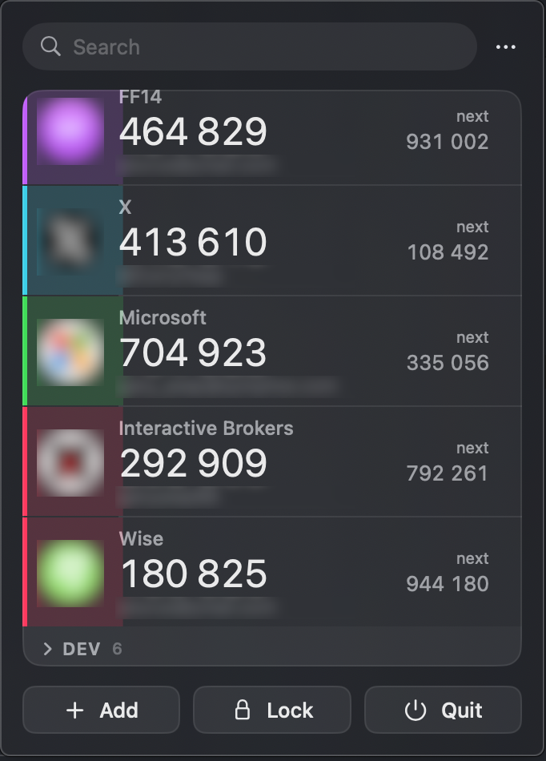
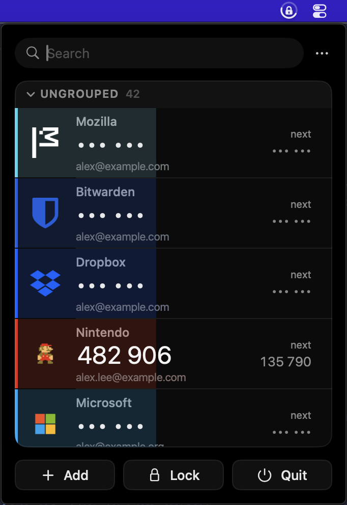

<p align="center">
  
</p>

<h1 align="center">TrayOTP</h1>

<p align="center">
  <a href="../README.md">English</a> · <a href="README.de.md">Deutsch</a> · <a href="README.es.md">Español</a> · <a href="README.fr.md">Français</a> ·
  <a href="README.it.md">Italiano</a> · <b>日本語</b> · <a href="README.ko.md">한국어</a> ·
  <a href="README.pt-BR.md">Português (Brasil)</a> · <a href="README.zh-Hans.md">简体中文</a> · <a href="README.zh-Hant.md">繁體中文</a>
</p>

<p align="center">
  <b>2要素認証コードを、macOSのメニューバーからワンクリックで。</b><br>
  Google Authenticator、2FAS、Aegis、Ente Auth、Bitwarden、Proton Authenticatorなどから読み込めます。暗号化、オフライン、オープンソース。
</p>

<p align="center">
  <a href="https://github.com/outerstudio/trayotp/releases/latest"></a>
  <a href="https://github.com/outerstudio/trayotp/actions/workflows/ci.yml"></a>
  
  <a href="../LICENSE"></a>
  <a href="https://buymeacoffee.com/garyyeap"></a>
  <a href="https://ko-fi.com/garyyeap"></a>
  <a href="https://liberapay.com/garyyeap"></a>
  <a href="https://thanks.dev/u/gh/garyyeap"></a>
</p>

<p align="center">
  <a href="#install">インストール</a> ·
  <a href="#getting-started">はじめに</a> ·
  <a href="#using-trayotp">TrayOTPの使いかた</a> ·
  <a href="#security">セキュリティ</a> ·
  <a href="#troubleshooting">トラブルシューティング</a>
</p>

<p align="center">
  
  
</p>

> この翻訳は[英語版README](../README.md)より古い場合があります。内容が異なる場合は英語版が優先されます。

## 機能

- **メニューバーに常駐。** アイコンをクリックし、コードをクリックすればコピー完了。Dockアイコンも、管理するウインドウもありません。
- **次のコードをプレビュー。** 各行の右側に次のコードが表示され、行の背景の半透明の塗りが現在のコードの残り時間を示します。
- **キーボードだけでも、クリックだけでも。** グローバルショートカット、入力して検索、↩でコピー、⌘↑/↓で並べ替え、Escで閉じる。
  [コードのコピー](#copying-codes)と[グループ](#groups)を参照してください。
- **一般的なトークンにすべて対応。** TOTP（SHA-1、SHA-256、SHA-512、6〜8桁、任意の周期）、HOTP（カウンタベース）、Steam Guard。
- **スマートフォンなしでトークンを追加。** `otpauth://`リンク、Base32シークレット、QRコードを含む画像をペーストするだけ。
- **自由に移行。** Google Authenticator、2FAS、Aegis、Ente Auth、Bitwarden、Proton Authenticator、
  Stratum、andOTP、FreeOTP+、Raivo OTP、パスワードマネージャのCSVから読み込み。2FAS、Aegis、Ente Auth、Bitwarden、Google Authenticatorへ書き出し。
- **グループ。** 折りたためるセクション、ドラッグ＆ドロップで並べ替え・移動。2FAS、Aegis、Enteの書き出しでも保持されます。
- **サービスアイコン。** 任意の[Aegisアイコンパック](#service-icons)を使ったり、手動で選んだり、自分の画像を使ったり、サイトのファビコンを取得したりできます。
- **デフォルトでロック。** コードを表示する前にTouch ID（またはMacのパスワード）を要求。さらにマスターパスワードも設定できます。
- **安全。** トークンはAES-256-GCMで暗号化され、鍵はログインキーチェーンに保存されます。[セキュリティ](#security)を参照してください。
- **プライベート。** すべてMacの中だけ。アカウント不要、同期なし、解析なし。
- **あなたの言語で。** English、Deutsch、Español、Français、Italiano、日本語、한국어、Português (Brasil)、简体中文、
  繁體中文。Macの言語に従うか、**⋯ → 言語**で選べます。
- **小さくネイティブ。** SwiftとSwiftUI製、数MB。macOS 14 Sonoma以降が必要。Appleシリコン・Intelの両方で動作します。

<a id="install"></a>
## インストール

### ダウンロード

1. [最新リリース](https://github.com/outerstudio/trayotp/releases/latest)から`TrayOTP-vX.Y.Z.zip`をダウンロードします。
2. 展開して、**TrayOTP.app**を**アプリケーション**フォルダに移動します。
3. 開きます。初回は、macOSがアプリを検証できないと表示します（下記参照）。

**警告が出る理由：** TrayOTPはオープンソースで、有料のApple Developer証明書で署名されていないため、
macOSは作成者を確認できません。それでも開くには：

- Appleの[未確認の開発元のMacアプリを開く方法](https://support.apple.com/ja-jp/guide/mac-help/mh40616/26/mac/26)のガイドに従い、ページ上でお使いのmacOSのバージョンを選んでください。

この操作はバージョンごとに一度だけ必要です。ダウンロードしたビルドを信頼したくない場合は、
約1分で[自分でビルド](#build-from-source)できます。

**ダウンロードの確認（任意）：** 各リリースには`.sha256`ファイルが含まれています。ターミナルで：

```sh
shasum -a 256 -c TrayOTP-vX.Y.Z.zip.sha256
```

<a id="build-from-source"></a>
### ソースからビルド

必要なのはAppleの**Command Line Tools**だけです：

```sh
xcode-select --install                                 # インストール済みなら不要
git clone https://github.com/outerstudio/trayotp.git
cd trayotp
make release                                           # build/TrayOTP.app をビルド
cp -R build/TrayOTP.app /Applications/
```

自分でビルドしたアプリは警告なしで開きます。

<a id="getting-started"></a>
## はじめに

1. メニューバーのTrayOTPアイコン（円の中の鍵）をクリックし、Touch IDでロックを解除します。
2. トークンを追加します：
   - **別のアプリから：** **追加 → ファイルから読み込む…**をクリック。Google Authenticatorの場合は
     **追加 → カメラでQRコードをスキャン…**（[読み込みと書き出し](#import-and-export)を参照）。
   - **1つずつ：** **追加**をクリックし、設定用リンクまたはシークレットをペースト（[トークンの追加](#adding-a-token)を参照）。
3. コードをクリックするとコピーされます。

<a id="using-trayotp"></a>
## TrayOTPの使いかた

<a id="copying-codes"></a>
### コードのコピー

- **どこからでも開く：** **⋯ → グローバルショートカットを設定…**でキーの組み合わせを設定し、どのアプリからでも押せます。
  **Esc**でパネルを閉じ、直前のアプリに戻ります。
- **コードをクリック**するとコピーされ、メッセージで確認できます。行の右側にある次のコードをクリック（または右クリック →「**次のコードをコピー**」）すると、そちらをコピーします。
- **キーボード：** パネルを開くと検索フィールドが選択されています。入力で絞り込み、**↑/↓**で選択、**return**（↩）でコピー、**→**で次のコードをコピー。
  一番上の行で**↑**を押すと検索フィールドに戻ります。
- カウンタベース（HOTP）のトークンは、右クリック →「**次のコード**」でカウンタを進めます。
- **トークンの編集：** 右クリック →「**編集…**」でサービス名とアカウントを変更できます。コードは変わりません。
- ⋯メニューの「**コピー後に閉じる**」をオンにすると、コピーするたびにパネルが閉じ、すぐにペーストできます。
- コピーしたコードはクリップボードマネージャから隠され、30秒後にクリップボードから消去されます。

<a id="adding-a-token"></a>
### トークンの追加

パネル下部の**追加**をクリックし、次のいずれかをペーストします：

| 手元にあるもの | 操作 |
|---|---|
| `otpauth://…`設定用リンク | ペーストします。名前、アカウント、設定はリンクから入力されます。 |
| `JBSW Y3DP EHPK 3PXP`のような秘密鍵 | ペーストして名前（例：「GitHub」）を入力します。スペースや小文字でも問題ありません。 |
| 画面上のQRコード | クリップボードにスクリーンショット（**⌃⇧⌘4**）、または画像を右クリック →「**イメージをコピー**」。次に**追加**を開く（自動で入力されます）か、**リンク、シークレット、QR画像をペースト**をクリックします。 |
| 別のデバイスや紙のQRコード | **カメラでQRコードをスキャン…**をクリックし、Macのカメラにかざします。 |

保存前にライブプレビューでコードが表示されるので、Webサイトの表示と比べられます。

> **ヒント：新しいトークンはスマートフォンにも同時に追加しましょう。** Webサイトが2FA設定用のQRコードを表示したら、
> スマートフォンのアプリ（Google Authenticator、2FAS、Aegis…）でスキャンし、*さらに*スクリーンショットでTrayOTPに追加します（**⌃⇧⌘4**、次に**追加**）。
> 同じシークレットなので両方に同じコードが表示され、スマートフォンやMacをなくしてもバックアップになります。
> Webサイトで確認コードを入力する前に行ってください。ほとんどのサイトはQRコードを二度と表示しません。
> QRコードがない場合は、設定キー（「スキャンできない場合」などの下にあることが多い）をコピーして両方のアプリに入力します。

<a id="groups"></a>
### グループ

- **グループを作成：** **⋯ → 新規グループ…**、またはトークンを右クリック →「**グループに移動 → 新規グループ…**」。
- **トークンを移動：** 右クリック →「**グループに移動**」、またはグループの見出しにドラッグします。
- **並べ替え：** トークンを別のトークンにドラッグします。行の上半分なら上に、下半分なら下に入ります。
  または選択して**⌘↑/⌘↓**を押します。グループの端を越えると次のグループに移ります。グループの見出しを別の見出しにドラッグするとグループを並べ替えられます。
- **折りたたむ：** グループの見出し（「グループなし」も）をクリックします。検索では折りたたんだグループ内のトークンも見つかります。
  ↑/↓で折りたたんだグループに選択を移すと、出るまで一時的に開きます。開閉状態を保存するのは見出しのクリックだけです。
- **グループの名前変更・移動・削除：** 見出しを右クリックします。グループを削除してもトークンは残り、「グループなし」に移動します。

<a id="service-icons"></a>
### サービスアイコン

TrayOTPにはブランドのロゴは含まれていません。代わりに
[Aegisアイコンパック形式](https://github.com/beemdevelopment/Aegis/blob/master/docs/iconpacks.md)のアイコンパックを読み込みます：

1. [aegis-iconsのリリース](https://github.com/aegis-icons/aegis-icons/releases)から`aegis-icons.zip`をダウンロードします
   （ほかのAegis互換パックでも構いません）。
2. **⋯ → Aegisアイコンパックをインストール…**でZIPを選びます。

トークンには発行者または名前に基づいて自動的にアイコンが付きます（「Google Workspace」→ Google）。
それ以外はトークンを右クリック：

| メニュー項目 | 内容 |
|---|---|
| **アイコンを編集…** | 現在のアイコンを調整（イニシャルではなくアイコンがある場合のみ） |
| **パックからアイコンを選択…** | インストールしたパックを検索して手動で選択 |
| **ファイルからアイコンを設定…** | 画像ファイルを使用（PNG、JPEG、SVG、HEIC、PDF…） |
| **アイコンをペースト** | コピーした画像を使用 |
| **Webサイトからアイコンを取得…** | サイトのファビコンをダウンロード（先にドメインを確認します） |
| **アイコンを削除** | 自動アイコンまたは色付きイニシャルに戻す |

まとめて設定するには、**⋯ → フォルダからアイコンを読み込む…**で画像ファイル名をトークン名に対応付けます
（`github.png` → GitHub）。自分で選んだアイコンは、パックの自動一致より常に優先されます。

> **プライバシーについて：** **Webサイトからアイコンを取得…**はDuckDuckGoのアイコンサービス経由でファビコンを取得するため、
> DuckDuckGoにそのドメインが伝わります。自分で選んだときだけ行われ、自動では行われません。

<a id="import-and-export"></a>
### 読み込みと書き出し

**読み込み：** **追加 → ファイルから読み込む…**でファイルを選びます。TrayOTPはアプリを判別し、ファイルが暗号化されていれば
バックアップのパスワードを求めます。読み込めなかったものは最後に一覧表示されます。

**書き出し：** **⋯ → 書き出す ▸**でアプリを選びます。最初にTouch IDが求められます。

| アプリ | 読み込み | 書き出し | グループ |
|---|---|---|---|
| **2FAS**（`.2fas`） | 暗号化なし／暗号化 | 暗号化なし／暗号化 | ✓ |
| **Aegis**（`.json`） | 暗号化なし／暗号化 | 暗号化なし／暗号化 | ✓（アイコンも） |
| **Ente Auth**（`.txt`） | プレーンテキスト | プレーンテキスト | ✓（タグとして） |
| **Google Authenticator** | 「アカウントを移行」のQRコード | QRコード（30秒、6桁または8桁） | — |
| **Bitwarden**と**Bitwarden Authenticator**（`.json`、`.csv`） | 暗号化なし | 暗号化なしのJSON（HOTPなし） | ✓（フォルダ） |
| **Proton Authenticator**（`.json`） | 暗号化なし／暗号化 | — | — |
| **Stratum** / Authenticator Pro | 暗号化なし／暗号化 | — | ✓（カテゴリ） |
| **andOTP**（`.json`、`.json.aes`） | 暗号化なし／暗号化 | — | ✓（最初のタグ） |
| **FreeOTP+**（`.json`） | ✓ | — | — |
| **Raivo OTP**（`.zip`、未検証、[ご報告ください](https://github.com/outerstudio/trayotp/issues)） | パスワード付きZIP | — | — |
| **Appleのパスワード**（`.csv`） | 確認コード（`OTPAuth`列） | — | — |
| **その他のパスワードマネージャ**（`.csv`、未検証、[ご報告ください](https://github.com/outerstudio/trayotp/issues)）：1Password、KeePassXC… | `OTPAuth`、`TOTP`、`login_totp`という名前の列 | — | ✓（フォルダ／グループ） |
| `otpauth://`リンクを並べたテキストファイル | ✓ | ✓ | — |

**Google Authenticator：** スマートフォンで**⋮ → アカウントを移行 → アカウントをエクスポート**を開きます。Googleはこの画面の
スクリーンショットをブロックするため、TrayOTPで**追加 → カメラでQRコードをスキャン…**をクリックし、画面を明るくしたスマートフォンを
Macのカメラから20–30cmほど離してかざします。コードに含まれるすべてのアカウントが一度に読み込まれます。Googleが複数のQRコードを
表示した場合は、それぞれスキャンしてください。密度の高いコードはWebカメラで読み取りにくいため、認識されない場合は一度に
エクスポートするアカウントを減らしてください。

内蔵カメラがない場合（Mac mini、Mac Studio、Mac Pro）は、USB Webカメラが使えます。Google Authenticatorが入っていない
iPhoneやiPadをWebカメラとして使うこともできます（連係カメラ）。または、移行画面を別のスマートフォンで撮影し、写真をMacに
送って（AirDrop、iCloud写真、メール…）**追加 → ファイルから読み込む…**で読み込みます。PNG、JPEG、HEICに対応しています。

**Google Authenticatorへ：** **⋯ → 書き出す → Google Authenticator（QRコード）…**でアカウントをQRコードとして表示します
（1コードあたり10件）。Google Authenticatorで**⋮ → アカウントを移行 → アカウントをインポート**を開き、それぞれスキャンします。
Googleは6桁または8桁の30秒コードのみに対応しているため、それ以外のトークン（とSteam）は除外され、どれが除外されたかが表示されます。
このウインドウはスクリーンショットや画面共有に写らず、TrayOTPがロックされると閉じます。

**重複：** 同じシークレットとアカウントのトークンがすでにある場合はスキップされるため、同じファイルを二度読み込んでも
（重なり合うGoogleのQRコードでも）何も増えません。名前とアカウントが既存のトークンと同じでシークレットが異なるトークンは残され、
名前の後ろに追加日時が付き（例：`GitHub 2026-11-17 23:40`）、読み込み後に一覧表示されます。通常はサイトが新しいシークレットを
発行したということなので、新しい方が使えることを確認したら古いトークンを削除してください。1つずつ追加した場合も同じです。

**未検証**とは、TrayOTPがドキュメントどおりに形式を読み込むものの、そのアプリから書き出したファイルではまだ試していないという意味です。
読み込みに失敗したり、コードが一致しなかったりした場合は、アプリ名とバージョンを添えて
[Issueを作成](https://github.com/outerstudio/trayotp/issues)してください（ファイルは絶対に添付しないでください。シークレットが含まれています）。

> **以前のアプリからトークンを削除する前に、** 読み込んだコードのいくつかが、そのアプリの表示と一致することを確認してください。

非対応：暗号化されたEnte Authの書き出し（Enteからプレーンテキストで書き出してください）、暗号化されたBitwardenの書き出し、
オリジナルのFreeOTPのバックアップ、AuthyとMicrosoft Authenticator（書き出し機能がありません）、YandexとmOTPのトークン。

> **暗号化なしの書き出しには、すべてのシークレットが平文で含まれます。** 読み込んだらファイルを削除してください。
> 保管するバックアップには**Aegis（暗号化）**を使ってください。そのパスワード保護（scrypt）は2FASよりはるかに破られにくくなっています。

### ロックと設定

すべて**⋯**メニューにあります：

| 設定 | 内容 |
|---|---|
| **ロック解除を要求** | コードを表示する前にTouch IDまたはMacのパスワードを求めます（デフォルトでオン）。 |
| **ロック解除を保つ ▸** | 最後に使ってからロック解除を保つ時間：毎回ロック、1分〜1時間、**Macがスリープまたはロックされるまで**、またはカスタムの分数。Macがスリープしたり画面がロックされたりすると必ずロックされます。 |
| **マスターパスワードを設定…** | トークンを書き出したり削除したりする前に入力するパスワードです（[セキュリティ](#security)を参照）。設定すると、メニューに変更、削除、**Touch IDの代わりにパスワードでロック解除**、そしてすべてのトークンを消去してやり直す**パスワードを忘れた場合…**が表示されます。 |
| **パスワードの再確認 ▸** | 忘れないように、7日、30日、90日ごと（またはカスタムの日数）にパスワードをもう一度求めます。デフォルトは30日です。 |
| **グローバルショートカットを設定…** | 好きなキーの組み合わせで、どのアプリからでもパネルを開きます（⌘、⌃、⌥のいずれかが必要）。 |
| **メニューバーにアイコンを表示** | オフにするとアイコンを隠します。グローバルショートカット（またはFinderやLaunchpadからTrayOTPを再度開く）で、画面上部にパネルが表示されます。 |
| **コピー後に閉じる** | コードをコピーしたらすぐにパネルを閉じ、そのままペーストできるようにします。 |
| **ディープブラックテーマ** | 半透明のマテリアルの代わりに真っ黒なパネル背景を使います。OLEDディスプレイ向けです。 |
| **ログイン時に起動** | ログイン時にTrayOTPを起動します。 |
| **言語 ▸** | 「**システムの言語**」はMacの言語に従います（TrayOTPが未対応の言語なら英語）。または翻訳を1つ選びます。切り替えるとTrayOTPが再起動します。 |

パネル下部の**ロック**をクリックすると、すぐにロックされます。

<p align="center">
  
</p>

<a id="security"></a>
## セキュリティ

### シークレットの保存方法

- トークンはMac上に暗号化（**AES-256-GCM**）して保存され、そのファイルはあなたのユーザアカウントしか読めません。
- 暗号鍵はランダムな256ビットの鍵で、ファイルの隣ではなく**ログインキーチェーン**に保存されます。
- 「**ロック解除を要求**」がオンの場合、ボールトはTouch IDまたはMacのパスワードの後にだけ復号され、再びロックされると
  復号されたトークンはメモリから破棄されます。
- **書き出し**、**トークンの削除**、**マスターパスワードの変更**は、TrayOTPのロックが解除されていても必ずパスワードを再度求めます。[マスターパスワード](#master-password)を参照してください。
- **Webサイトからアイコンを取得…**で自分で調べるドメインを除き、何もMacの外に出ません。
- カメラは**QRコードをスキャン**ウインドウが開いている間だけ使用されます。映像はメモリ上で読み取られ、保存されることはありません。
  初回はmacOSがカメラへのアクセスを確認し、アップデート後に再度確認されることがあります（TrayOTPはアドホック署名です）。

<a id="master-password"></a>
### マスターパスワード

Touch IDでは、あなたが寝ている間に誰かが指を使えてしまうため、TrayOTPは入力するパスワードを求めます。
最初のトークンを追加または読み込むと、TrayOTPは**マスターパスワード**の設定を求めます。次の操作の前に確認されます：

- トークンの書き出し（このパスワードはデフォルトでバックアップファイルの暗号化にも使われます。書き出しごとに別のパスワードも選べます）
- トークンの削除（一度入力すると、2分以内の削除では再度求められません）
- 1つのトークンをQRコードとして表示（右クリック → **書き出す…**、別の認証アプリに追加するため。
  パスワードを一度入力すると、3分以内のQRコードでは再度求められません）
- パスワードの変更または削除

デフォルトでは、TrayOTPを開くときのTouch IDの代わりにはなりません。**⋯ → マスターパスワード → Touch IDの代わりにパスワードでロック解除**
をオンにすると、キーチェーン内のボールトの鍵自体が同じパスワードから導出した鍵で暗号化されます
（scrypt、N=2¹⁷、r=8、p=1：1回の試行に約0.5秒と128MB）。キーチェーンに侵入されても、パスワードを推測する必要があります。
オン・オフの切り替えやパスワードの変更で新しいボールトの鍵に切り替わるため、古いキーチェーンのコピー
（Time Machineバックアップ内など）では以後ボールトを開けません。

**忘れると復元できません。** ロック解除オプションがない場合、元に戻る唯一の方法は
**⋯ → マスターパスワード → パスワードを忘れた場合…**で、すべてのトークンが消去されます。オンの場合、トークンはまったく
復元できません。TrayOTPだけに頼る前に、各アカウントに別の方法（バックアップコードや暗号化した書き出し）でサインインできる
ことを確認してください。**パスワードの再確認**は、パスワードを忘れないよう一定日数ごとに入力を求めます。

*リスクを理解しています*と入力してスキップすることもできます。その場合、書き出しと削除はTouch IDまたはMacのパスワードだけを
求め、ロック解除済みのMacの前にいる人は誰でもすべてのトークンを書き出せます。また、スキップするとすき間が残ります。
最初にTrayOTPを開いた人がパスワードを設定できてしまいます。後から**⋯ → マスターパスワードを設定…**でオンにできます。

<a id="limitations"></a>
### 制限事項

- TrayOTPはApple Developer証明書で署名されていないため、macOSはキーチェーン内でボールトの鍵をTouch IDに結び付けることを
  許可しません。Touch IDはアプリによって強制され、ほかのアプリが鍵を要求するとmacOSの
  **「キーチェーンを使用しようとしています」**というダイアログが表示されます。このダイアログが表示されるのは、TrayOTPを
  アップデートした直後に開いたときだけのはずです。**それ以外のタイミングで表示された場合や、TrayOTP以外のアプリ名が表示された場合は、
  「拒否」をクリックしてください：** 何かがトークンを守る鍵を読み取ろうとしています。
- シークレットの安全性はMacの安全性次第です。**FileVault**をオンにし、**Time Machineバックアップを暗号化**し、強力なログイン
  パスワードを使ってください。ボールトファイルとログインキーチェーンの両方が盗まれた場合、守りになるのはログインパスワード
  （設定していればマスターパスワードも）です。
- ビルドはHardened Runtimeを使用しており、ほかのプロセスがTrayOTPにコードを注入したり、デバッガを接続したりすることを防ぎます。

セキュリティ上の問題を見つけた場合は、公開のIssueではなく、リポジトリの
[Securityタブ](https://github.com/outerstudio/trayotp/security)から非公開で報告してください。

<a id="troubleshooting"></a>
## トラブルシューティング

- **アップデート後に「TrayOTPがキーチェーンを使用しようとしています」**
  - リリースごとに個別に署名されるため、macOSはアップデートのたびに再度確認します。ログインキーチェーンのパスワード
    （通常はMacのパスワード）を入力し、**常に許可**を選んでください。それ以外のタイミングで表示された場合は
    [制限事項](#limitations)を参照してください。
- **Launchpadのアイコンが空白になる**
  - Launchpadは`/Applications`内のアプリだけを表示します。アプリをそこに移動してもアイコンが空白のままなら、`killall Dock`を実行してください。
- **QRコードが認識されない**
  - スクリーンショットをコードの周りでもっと小さく切り取ってください。Google Authenticatorの場合は**追加 → カメラでQRコードをスキャン…**
    を使ってください（[読み込みと書き出し](#import-and-export)を参照）。
- **「バックアップのパスワードが違います」**
  - Macのパスワードではなく、別のアプリ（またはTrayOTP）からバックアップを書き出したときに設定したパスワードを使ってください。

## 自己責任でのご利用

TrayOTPは無料のオープンソースソフトウェアで、現状のまま、いかなる保証もなく提供されます（[ライセンス](../LICENSE)を参照）。
作者は、アカウントへのアクセスの喪失、シークレットの紛失や漏えい、その他いかなる損害についても責任を負いません。

2FAコードを失うとアカウントにログインできなくなることがあるため、TrayOTPを唯一のコピーにしないでください：

- 2FAを設定するときに、各サイトの**リカバリーコード**を保存してください。
- スマートフォンなど、2つ目のアプリにもトークンを入れておいてください（[トークンの追加](#adding-a-token)のヒントを参照）。
- ときどき暗号化したバックアップを書き出し（**⋯ → 書き出す → Aegis（暗号化）**）、安全な場所に保管してください。
- 読み込んだ後は、以前のアプリから何かを削除する前にいくつかのコードを確認してください。

## サポート

TrayOTPは無料です。時間の節約になったら、[コーヒーをおごってください](https://buymeacoffee.com/garyyeap)
（⋯メニューからも開けます）。[Ko-fi](https://ko-fi.com/garyyeap)、[Liberapay](https://liberapay.com/garyyeap)、[thanks.dev](https://thanks.dev/u/gh/garyyeap)からの支援も歓迎です。

## 開発

ビルド、テスト、プロジェクト構成、翻訳、形式の詳細は[英語版README](../README.md#development)にあります。
[クレジット](../README.md#credits)も英語版をご覧ください。

## ライセンス

[MIT](../LICENSE) © 2026 outerstudio.com
