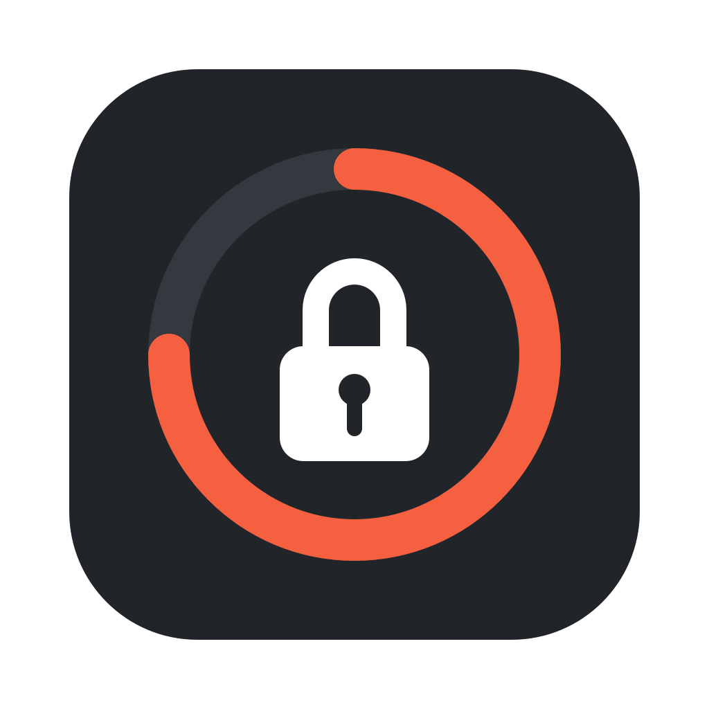

<p align="center">
  
</p>

<h1 align="center">TrayOTP</h1>

<p align="center">
  <a href="../README.md">English</a> · <a href="README.de.md">Deutsch</a> · <a href="README.es.md">Español</a> · <a href="README.fr.md">Français</a> ·
  <a href="README.it.md">Italiano</a> · <a href="README.ja.md">日本語</a> · <a href="README.ko.md">한국어</a> ·
  <a href="README.pt-BR.md">Português (Brasil)</a> · <a href="README.zh-Hans.md">简体中文</a> · <b>繁體中文</b>
</p>

<p align="center">
  <b>你的雙重認證驗證碼，在 macOS 選單列中一鍵可得。</b><br>
  可從 Google 驗證器、2FAS、Aegis、Ente Auth、Bitwarden、Proton Authenticator 等輸入。加密、離線、開放原始碼。
</p>

<p align="center">
  <a href="https://github.com/outerstudio/trayotp/releases/latest"></a>
  <a href="https://github.com/outerstudio/trayotp/actions/workflows/ci.yml"></a>
  
  <a href="../LICENSE"></a>
  <a href="https://buymeacoffee.com/garyyeap"></a>
</p>

<p align="center">
  <a href="#install">安裝</a> ·
  <a href="#getting-started">快速入門</a> ·
  <a href="#using-trayotp">使用 TrayOTP</a> ·
  <a href="#security">安全性</a> ·
  <a href="#troubleshooting">疑難排解</a>
</p>

<p align="center">
  
</p>

> 本譯文可能落後於[英文 README](../README.md)。如有出入，以英文版為準。

## 功能

- **常駐選單列。** 按一下圖像，再按一下驗證碼，就已拷貝。沒有 Dock 圖像，也沒有需要管理的視窗。
- **預覽下一個驗證碼。** 每列右側顯示即將生效的驗證碼，列背後的半透明填色顯示目前驗證碼的剩餘時間。
- **純鍵盤或純滑鼠，隨你選擇。** 全域快速鍵、輸入即搜尋、↩ 拷貝、⌘↑/↓ 調整順序、Esc 關閉。
  請參閱[拷貝驗證碼](#copying-codes)和[群組](#groups)。
- **支援所有常見的代符類型。** TOTP（SHA-1、SHA-256、SHA-512，6–8 位數，任意週期）、HOTP（以計數器為基礎）和 Steam Guard。
- **不需要手機就能加入代符。** 貼上 `otpauth://` 連結、Base32 密鑰或包含 QR 碼的影像即可。
- **自由移入移出。** 可從 Google 驗證器、2FAS、Aegis、Ente Auth、Bitwarden、Proton Authenticator、
  Stratum、andOTP、FreeOTP+、Raivo OTP 和密碼管理工具 CSV 輸入；可輸出到 2FAS、Aegis、Ente Auth、Bitwarden 和 Google 驗證器。
- **群組。** 可收合的區段，拖放即可排序和移動代符，在 2FAS、Aegis 和 Ente 輸出中保留。
- **服務圖像。** 可使用任何 [Aegis 圖像包](#service-icons)、手動挑選圖像、使用自己的影像，或取得網站的網站圖像。
- **預設鎖定。** 顯示驗證碼前需要 Touch ID（或 Mac 密碼），還可另外設定主密碼。
- **安全。** 代符以 AES-256-GCM 加密，密鑰保存在你的登入鑰匙圈中。請參閱[安全性](#security)。
- **私密。** 所有資料都留在你的 Mac 上。不需要帳號，不同步，不做分析。
- **使用你的語言。** English、Deutsch、Español、Français、Italiano、日本語、한국어、Português (Brasil)、简体中文和
  繁體中文。跟隨 Mac 的語言，或在 **⋯ → 語言**中選擇。
- **小巧原生。** 以 Swift 和 SwiftUI 製作，僅數 MB。需要 macOS 14 Sonoma 或以上版本；支援 Apple 晶片和 Intel。

<a id="install"></a>
## 安裝

### 下載

1. 從[最新版本](https://github.com/outerstudio/trayotp/releases/latest)下載 `TrayOTP-vX.Y.Z.zip`。
2. 解壓縮後將 **TrayOTP.app** 移到「**應用程式**」檔案夾。
3. 打開它。第一次打開時，macOS 會提示無法驗證此 App（見下方說明）。

**為什麼會有警告？** TrayOTP 是開放原始碼軟體，並未使用付費的 Apple Developer 憑證簽署，因此
macOS 無法確認開發者。若要照常打開：

- **macOS 15 Sequoia 及以上版本：** 先打開一次 App 並關閉警告，然後前往
  **系統設定 → 隱私權與安全性**，向下捲動，按一下 TrayOTP 旁的**強制打開**。
- **macOS 14 Sonoma：** 按右鍵點一下 **TrayOTP.app** → **打開** → **打開**。

每個版本只需操作一次。若你不想信任下載的版本，
可以在大約一分鐘內[自行建置](#build-from-source)。

**驗證下載內容（選用）：** 每個版本都附有 `.sha256` 檔案。在「終端機」中執行：

```sh
shasum -a 256 -c TrayOTP-vX.Y.Z.zip.sha256
```

<a id="build-from-source"></a>
### 從原始碼建置

只需要 Apple 的 **Command Line Tools**：

```sh
xcode-select --install                                 # 已安裝則略過
git clone https://github.com/outerstudio/trayotp.git
cd trayotp
make release                                           # 建置 build/TrayOTP.app
cp -R build/TrayOTP.app /Applications/
```

自行建置的 App 打開時不會有任何警告。

<a id="getting-started"></a>
## 快速入門

1. 按一下選單列中的 TrayOTP 圖像（圓圈裡的鎖），使用 Touch ID 解鎖。
2. 加入代符：
   - **從其他 App：** 按一下**加入 → 從檔案輸入⋯**；若是 Google 驗證器，按一下
     **加入 → 用相機掃描 QR 碼⋯**（請參閱[輸入和輸出](#import-and-export)）。
   - **逐一加入：** 按一下**加入**，貼上設定連結或密鑰（請參閱[加入代符](#adding-a-token)）。
3. 按一下任何驗證碼即可拷貝。

<a id="using-trayotp"></a>
## 使用 TrayOTP

<a id="copying-codes"></a>
### 拷貝驗證碼

- **隨處打開：** 在 **⋯ → 設定全域快速鍵⋯** 中設定組合鍵，然後在任何 App 中按下。
  **Esc** 會關閉面板並回到你先前使用的 App。
- **按一下驗證碼**即可拷貝，會有訊息確認。按一下列右側的下一個驗證碼（或按右鍵 →「**拷貝下一個驗證碼**」）則拷貝下一個驗證碼。
- **鍵盤：** 面板打開時搜尋欄位為作用中。輸入以篩選，**↑/↓** 選取，**Return**（↩）拷貝，**→** 拷貝下一個驗證碼。
  在第一列按 **↑** 會回到搜尋欄位。
- 若是以計數器為基礎（HOTP）的代符，按右鍵 →「**下一個驗證碼**」以推進計數器。
- **編輯代符：** 按右鍵 →「**編輯⋯**」可更改服務名稱和帳號。驗證碼保持不變。
- 開啟 ⋯ 選單中的「**拷貝後關閉**」後，每次拷貝都會關閉面板，方便立即貼上。
- 拷貝的驗證碼會對剪貼板管理工具隱藏，並在 30 秒後從剪貼板清除。

<a id="adding-a-token"></a>
### 加入代符

按一下面板底部的**加入**，然後貼上以下任一項：

| 你有 | 操作 |
|---|---|
| `otpauth://…` 設定連結 | 直接貼上。名稱、帳號和設定會從連結中填入。 |
| 類似 `JBSW Y3DP EHPK 3PXP` 的密鑰 | 貼上並輸入名稱（例如「GitHub」）。空格和小寫字母都沒問題。 |
| 螢幕上的 QR 碼 | 截圖到剪貼板（**⌃⇧⌘4**），或按右鍵點一下影像 →「**拷貝影像**」。然後打開**加入**（會自動填入），或按一下**貼上連結、密鑰或 QR 影像**。 |
| 其他裝置或紙上的 QR 碼 | 按一下**用相機掃描 QR 碼⋯**，將其對準 Mac 的相機。 |

儲存前會即時預覽驗證碼，方便你與網站核對。

> **提示：同時將新代符加入手機。** 當網站顯示雙重認證設定 QR 碼時，
> 用手機 App（Google 驗證器、2FAS、Aegis⋯）掃描，*同時*截圖加入 TrayOTP（**⌃⇧⌘4**，然後**加入**）。
> 這是同一個密鑰，兩邊顯示的驗證碼相同；就算遺失手機或 Mac，你也還有備份。
> 請在網站上輸入確認碼之前完成：大多數網站不會再顯示該 QR 碼。
> 沒有 QR 碼？拷貝設定密鑰（通常位於「無法掃描？」下方），在兩個 App 中分別輸入。

<a id="groups"></a>
### 群組

- **製作群組：** **⋯ → 新增群組⋯**，或按右鍵點一下代符 →「**移到群組 → 新增群組⋯**」。
- **移動代符：** 按右鍵 →「**移到群組**」，或將其拖到群組標題上。
- **調整順序：** 將代符拖到另一個代符上：放在該列上半部會排在其上方，下半部則在其下方。
  也可以選取後按 **⌘↑/⌘↓**；越過群組結尾時會移入下一個群組。將群組標題拖到另一個標題上可調整群組順序。
- **收合：** 按一下群組標題（「未分組」也可以）。搜尋一定能找到收合群組中的代符。
  以 ↑/↓ 將選取移入收合的群組時，它會展開直到你移出；只有按一下標題才會儲存展開或收合狀態。
- **重新命名、移動或刪除群組：** 按右鍵點一下其標題。刪除群組會保留其中的代符，它們會移到「未分組」。

<a id="service-icons"></a>
### 服務圖像

TrayOTP 不附帶品牌標誌，而是讀取
[Aegis 圖像包格式](https://github.com/beemdevelopment/Aegis/blob/master/docs/iconpacks.md)的圖像包：

1. 從 [aegis-icons 發佈頁面](https://github.com/aegis-icons/aegis-icons/releases)下載 `aegis-icons.zip`
   （或任何相容 Aegis 的圖像包）。
2. **⋯ → 安裝 Aegis 圖像包⋯**，然後選擇 ZIP 檔案。

代符會依發行者或名稱自動配對圖像（「Google Workspace」→ Google）。
其他情況下，按右鍵點一下代符：

| 選單項目 | 作用 |
|---|---|
| **編輯圖像⋯** | 調整目前的圖像（僅限代符有圖像而非首字母時） |
| **從圖像包選擇圖像⋯** | 搜尋已安裝的圖像包並手動挑選圖像 |
| **從檔案設定圖像⋯** | 使用影像檔案（PNG、JPEG、SVG、HEIC、PDF⋯） |
| **貼上圖像** | 使用你拷貝的影像 |
| **從網站取得圖像⋯** | 下載網站的網站圖像（先確認網域） |
| **移除圖像** | 恢復為自動圖像或彩色首字母 |

若要一次設定多個，**⋯ → 從檔案夾輸入圖像⋯** 會將影像檔名與代符名稱配對
（`github.png` → GitHub）。你自己選擇的圖像一律優先於圖像包的自動配對。

> **隱私權說明：** **從網站取得圖像⋯** 會透過 DuckDuckGo 的圖像服務下載網站圖像，因此
> DuckDuckGo 會看到該網域。只有在你主動選擇時才會發生，絕不會自動進行。

<a id="import-and-export"></a>
### 輸入和輸出

**輸入：** **加入 → 從檔案輸入⋯**，然後選擇檔案。TrayOTP 會辨識 App，檔案已加密時會要求輸入備份密碼。
無法輸入的項目會在最後列出。

**輸出：** **⋯ → 輸出 ▸**，然後選擇 App。TrayOTP 會先要求 Touch ID。

| App | 輸入 | 輸出 | 群組 |
|---|---|---|---|
| **2FAS**（`.2fas`） | 未加密或加密 | 未加密或加密 | ✓ |
| **Aegis**（`.json`） | 未加密或加密 | 未加密或加密 | ✓（含圖像） |
| **Ente Auth**（`.txt`） | 純文字 | 純文字 | ✓（作為標籤） |
| **Google 驗證器** | 「轉移帳戶」QR 碼 | QR 碼（30 秒，6 或 8 位數） | — |
| **Bitwarden** 和 **Bitwarden Authenticator**（`.json`、`.csv`） | 未加密 | 未加密 JSON（不含 HOTP） | ✓（檔案夾） |
| **Proton Authenticator**（`.json`） | 未加密或加密 | — | — |
| **Stratum** / Authenticator Pro | 未加密或加密 | — | ✓（類別） |
| **andOTP**（`.json`、`.json.aes`） | 未加密或加密 | — | ✓（第一個標籤） |
| **FreeOTP+**（`.json`） | ✓ | — | — |
| **Raivo OTP**（`.zip`，未經測試，[請回報](https://github.com/outerstudio/trayotp/issues)） | 受密碼保護的 ZIP | — | — |
| **Apple 密碼**（`.csv`） | 驗證碼（`OTPAuth` 欄） | — | — |
| **其他密碼管理工具**（`.csv`，未經測試，[請回報](https://github.com/outerstudio/trayotp/issues)）：1Password、KeePassXC⋯ | 名為 `OTPAuth`、`TOTP` 或 `login_totp` 的欄 | — | ✓（檔案夾／群組） |
| 任何包含 `otpauth://` 連結的文字檔 | ✓ | ✓ | — |

**Google 驗證器：** 在手機上打開 **⋮ → 轉移帳戶 → 匯出帳戶**。Google 禁止對此畫面截圖，
因此請在 TrayOTP 中按一下**加入 → 用相機掃描 QR 碼⋯**，將調高亮度的手機對準 Mac 的相機，距離約 20–30 公分。
QR 碼中的所有帳號會一次輸入。若 Google 顯示多個 QR 碼，請逐一掃描。密集的 QR 碼較難被網路攝影機辨識：
若無法辨識，請減少每次匯出的帳號數量。

沒有內建相機（Mac mini、Mac Studio、Mac Pro）？可以使用 USB 網路攝影機，也可以將沒有安裝 Google 驗證器的
iPhone 或 iPad 用作網路攝影機（接續互通相機）。或者用另一支手機拍下轉移畫面，把照片傳到 Mac（AirDrop、iCloud 照片、郵件⋯），
再透過**加入 → 從檔案輸入⋯** 輸入：支援 PNG、JPEG 和 HEIC。

**輸出到 Google 驗證器：** **⋯ → 輸出 → Google 驗證器（QR 碼）⋯** 會以 QR 碼顯示帳號，
每個 QR 碼 10 個。在 Google 驗證器中打開 **⋮ → 轉移帳戶 → 匯入帳戶**，逐一掃描。Google 只接受 6 或 8 位數的
30 秒驗證碼，因此其他代符（以及 Steam）會被略過，並告訴你是哪些。
此視窗不會出現在截圖和螢幕共享中，並會在 TrayOTP 鎖定時關閉。

**重複項目：** 若已有密鑰和帳號皆相同的代符，就會略過，因此重複輸入同一個檔案（或彼此重疊的 Google QR 碼）
不會新增任何內容。名稱和帳號與現有代符相同但密鑰不同的代符會保留，名稱後加上加入時間（例如 `GitHub 2026-11-17 23:40`），
並在輸入後列出。這通常表示網站核發了新密鑰；確認新代符可用後，請刪除舊代符。逐一加入代符時也是如此。

**未經測試**表示 TrayOTP 依照文件讀取該格式，但尚未用該 App 實際輸出的檔案測試過。
若輸入失敗或驗證碼不符，請[提出 issue](https://github.com/outerstudio/trayotp/issues) 並註明 App 名稱和版本
（切勿附上檔案：其中包含你的密鑰）。

> **在舊 App 中刪除代符之前，** 請確認幾個輸入的驗證碼與舊 App 顯示的一致。

不支援：加密的 Ente Auth 輸出（請改為從 Ente 輸出純文字）、加密的 Bitwarden 輸出、原版 FreeOTP 的備份、
Authy 和 Microsoft Authenticator（它們無法輸出），以及 Yandex 和 mOTP 代符。

> **未加密的輸出檔案以純文字包含你所有的密鑰。** 輸入後請刪除該檔案。
> 若要長期保存備份，請使用 **Aegis（加密）**：它的密碼保護（scrypt）比 2FAS 更難破解。

### 鎖定和設定

全部位於 **⋯** 選單中：

| 設定 | 作用 |
|---|---|
| **要求解鎖** | 顯示驗證碼前要求 Touch ID 或 Mac 密碼（預設開啟）。 |
| **保持解鎖 ▸** | 上次使用後 TrayOTP 保持解鎖的時間：每次都鎖定、1 分鐘到 1 小時、**直到 Mac 睡眠或鎖定**，或自訂分鐘數。Mac 睡眠或螢幕鎖定時一定會鎖定。 |
| **設定主密碼⋯** | 以你自己的密碼保護保險庫，以輸入密碼取代 Touch ID（請參閱[安全性](#security)）。 |
| **設定全域快速鍵⋯** | 用你選擇的組合鍵從任何 App 打開面板（需包含 ⌘、⌃ 或 ⌥）。 |
| **顯示選單列圖像** | 關閉後隱藏圖像。之後透過全域快速鍵（或在 Finder、啟動台中再次打開 TrayOTP）在螢幕頂端顯示面板。 |
| **拷貝後關閉** | 拷貝驗證碼後立即關閉面板，方便馬上貼上。 |
| **登入時啟動** | 登入時啟動 TrayOTP。 |
| **語言 ▸** | 「**系統語言**」跟隨 Mac 的語言（若 TrayOTP 沒有該語言的翻譯則使用英文），也可以選擇其中一種翻譯。切換時 TrayOTP 會重新啟動。 |

按一下面板底部的**鎖定**可立即鎖定。

<p align="center">
  
</p>

<a id="security"></a>
## 安全性

### 密鑰的儲存方式

- 代符以加密形式（**AES-256-GCM**）儲存在你的 Mac 上，該檔案只有你的使用者帳號可以讀取。
- 加密密鑰是隨機的 256 位元密鑰，保存在你的**登入鑰匙圈**中，從不和檔案放在一起。
- 開啟**要求解鎖**後，只有在 Touch ID 或 Mac 密碼驗證後才會解密保險庫，再次鎖定時已解密的代符會從記憶體中清除。
- **輸出**和**刪除代符**一律會再次要求 Touch ID，即使 TrayOTP 已解鎖。
- 除了你透過**從網站取得圖像⋯** 主動查詢的網域外，沒有任何資料會離開你的 Mac。
- 相機只在**掃描 QR 碼**視窗打開時使用。畫面只在記憶體中讀取，從不儲存。
  macOS 第一次會要求相機權限，更新後可能會再次要求（TrayOTP 使用臨時簽署）。

### 選用的主密碼

使用 **⋯ → 設定主密碼⋯** 後，鑰匙圈中的保險庫密鑰本身會以從你的密碼衍生的密鑰加密
（scrypt，N=2¹⁷，r=8，p=1：每次嘗試約 0.5 秒、128 MB）。即使有人進入你的鑰匙圈，仍須猜出密碼。
之後你將以密碼而非 Touch ID 解鎖。

設定、更改或移除主密碼都會切換到新的保險庫密鑰，因此舊的鑰匙圈副本（例如時光機備份中的副本）之後無法打開保險庫。

> **若忘記主密碼，代符將無法復原。** 請將加密的輸出檔案保存在安全的地方。

<a id="limitations"></a>
### 限制

- TrayOTP 並未使用 Apple Developer 憑證簽署，因此 macOS 不允許它在鑰匙圈中將保險庫密鑰與 Touch ID 綁定。
  Touch ID 由 App 強制執行；若其他 App 要求該密鑰，macOS 會顯示 **「想要使用你的鑰匙圈」** 提示。
  你只應在更新 TrayOTP 後第一次打開時看到這個提示。**若在其他時候出現，或提示中的 App 不是 TrayOTP，請按一下「拒絕」：**
  有其他程式正試圖讀取保護你代符的密鑰。
- 你的密鑰只和你的 Mac 一樣安全。請開啟 **FileVault**、**加密時光機備份**，並使用強度高的登入密碼。
  若保險庫檔案和登入鑰匙圈同時遭竊，擋在中間的就是登入密碼（以及你設定的主密碼）。
- 建置版本使用強化執行階段，可防止其他程序將程式碼注入 TrayOTP 或附加除錯器。

發現安全性問題？請透過儲存庫的 [Security 標籤頁](https://github.com/outerstudio/trayotp/security)私下回報，不要提出公開 issue。

<a id="troubleshooting"></a>
## 疑難排解

**更新後出現「TrayOTP 想要使用你的鑰匙圈」**
每個版本都是分開簽署的，所以每次更新後 macOS 都會再次詢問。輸入登入鑰匙圈密碼（通常就是 Mac 密碼），然後選擇**永遠允許**。
若在其他時候出現，請參閱[限制](#limitations)。

**啟動台顯示空白圖像**
啟動台只會列出 `/Applications` 中的 App。若移到該處後圖像仍為空白，請執行 `killall Dock`。

**無法辨識 QR 碼**
將截圖裁切得更貼近 QR 碼。若是 Google 驗證器，請使用**加入 → 用相機掃描 QR 碼⋯**（請參閱[輸入和輸出](#import-and-export)）。

**「備份密碼錯誤」**
請使用從其他 App（或 TrayOTP）輸出備份時設定的密碼，而不是 Mac 密碼。

## 風險自負

TrayOTP 是免費的開放原始碼軟體，依「現狀」提供，不附帶任何形式的擔保（請參閱[授權](../LICENSE)）。
對於帳號無法存取、密鑰遺失或外洩，或任何其他損失，作者概不負責。

遺失雙重認證驗證碼可能會讓你無法登入帳號，所以不要讓 TrayOTP 成為唯一的副本：

- 設定雙重認證時，保存每個網站的**復原代碼**。
- 在第二個 App（例如手機上的 App）中也保留該代符（請參閱[加入代符](#adding-a-token)中的提示）。
- 不時輸出加密備份（**⋯ → 輸出 → Aegis（加密）**）並妥善保存。
- 輸入後，在舊 App 中刪除任何內容之前，先核對幾個驗證碼。

## 支持

TrayOTP 是免費的。若它為你節省了時間，歡迎[請我喝杯咖啡](https://buymeacoffee.com/garyyeap)
（也可在 ⋯ 選單中找到）。

## 開發

建置、測試、專案結構、翻譯和格式細節請參閱[英文 README](../README.md#development)，
[致謝](../README.md#credits)也在那裡。

## 授權

[MIT](../LICENSE) © 2026 outerstudio.com
